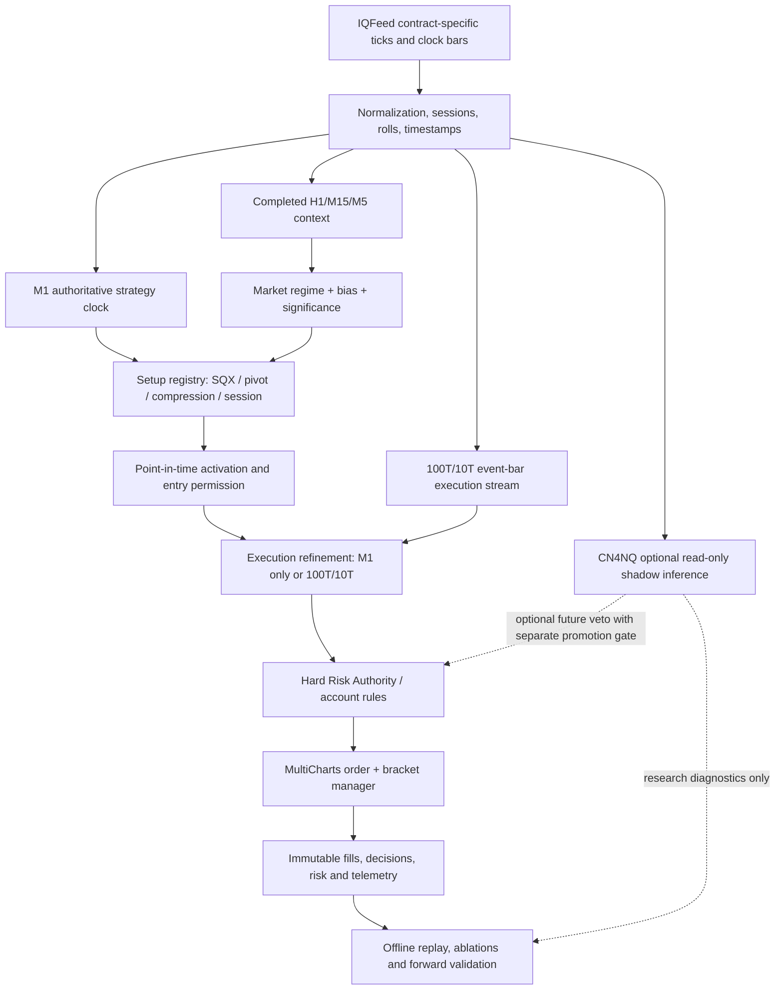

# QMTF NQ/MNQ Multi-Timeframe Automated Trading System
## Technical Implementation Plan, Validation Contract, and Release Roadmap

**Document ID:** QMTF-MTF-ATS-PLAN-001  
**Version:** 0.1.0 — initial design and research specification  
**Date:** November 10, 2026  
**Project:** ATS for NQ & MNQ MC  
**Trading environments:** MultiCharts PowerLanguage / compatible EasyLanguage; Python for deterministic research; IQFeed for canonical data; optional CN4F native telemetry bridge  
**Status:** PLANNED — NOT IMPLEMENTED, VALIDATED, OR AUTHORIZED FOR AUTONOMOUS BROKER EXECUTION  
**Task register:** [`tasks.md`](tasks.md)

---

## 0. Executive decision

Build on **StrategyQuant X strategy 1.10.153** rather than replace it. First produce a trade-for-trade reproducible baseline, then expose hidden parameters and optimize the existing entry and exit logic with strict risk/overfitting controls. In independently measured additions, introduce (i) deterministic protective stops and runner management, (ii) completed-bar H1/M15/M5 market context and session state, (iii) lower-level 100T/10T execution, (iv) two or more independently validated entry families, and (v) optional CN4NQ intelligence in **shadow mode** before any potential use as a deterministic veto or advisory score.

**Primary research hypotheses:**

1. The present SQX strategy may enter after the high-quality launch point because its ATR-offset stop entry is relatively distant; a conditional pullback/retest or lower-timeframe execution trigger may improve price **without sacrificing fill rate or expectancy**.
2. Its nominal 365-tick TP and 95-bar holding cap can truncate some strong continuations; a separately tested trailing/runner option may increase net expectancy after paying for additional giveback, adverse movement and commissions.
3. Some losses may be shortened by a better initial hard stop, time-based invalidation, or structure/PSAR exit; we must not assume this without replay.
4. Markets immediately after a major Asia-related session anchor may need a measurable directional-establishment period; waiting must be compared with the cost of missed moves.
5. Distinct additional entry setups may expand opportunity coverage if they add independent edge instead of replaying the same market state.
6. CN4NQ's deterministic research architecture can improve **evaluation and feature governance immediately**, whereas learned CN4NQ forecasts are subject to much later model-specific validation.

The objective is **not** maximization of historical net profit. It is a reproducible, cost-aware, account-safe NQ/MNQ strategy with positive incremental utility under independent forward conditions.

## 1. Provenance and evidence boundary

### 1.1 Source materials examined / available for this plan

| Source | Observed status | What this plan uses |
|---|---|---|
| Uploaded `Pasted text.txt` | SQX-generated EasyLanguage 1.10.153; intrabar order generation false; source generated July 18, 2026 | Actual entry/exit expressions, default constants, protective-stop code defect candidate |
| Uploaded `Backtesting Strategy Performance Report _ @NQZ26 - 1 Minute NQ_M1Strategy110153_July_17_2026.xlsx` | MultiCharts export produced November 10, 2026; `@NQZ26`, M1 | Summary, list-of-trades, cost assumptions, dates, settings; **not yet independently reproduced** |
| Uploaded optimizer screenshot | 23 declared inputs all have single-value start/end; genetic algorithm chosen | Existing optimization UI behavior; main alpha constants are hard-coded |
| `trextrader/CondorNet-4-Futures` README and `DEVELOPMENT_STATUS.md` (connected GitHub) | Foundation, schemas, native MC bridge operational in historical checkpoint; model SuperSet validation still incomplete | Causal contracts, risk gates, telemetry, caution on PSAR/feature schema |
| `trextrader/dr-quantor-pb2native` README | Phase 1.3 MTF replay mismatch; full replay equivalence not achieved | Reuse conceptual design; **do not trust replay-derived signals for orders** |
| `trextrader/NQ-LLM-Lab` README | Research-only, `NO_ENTRY` default, deterministic authority; 188 features/timeframe in v0.4.x | Candidate MTF predicates, model readiness gates, zero LLM order authority |
| CN4NQ Part III / IV / XIII / XIV reports | Research methodology and historical audits | Causal bar joins, canonical signal registry, retrospective pivots, GOLD geometry |
| August 2026 Build Alpha pivot research and PRE-OOS pair report | Historical optimized candidates and pre-OOS locked results | Candidate discovery sources; **no claims of forward profitability** |
| Historical PB2 v7.2c Pine sources | Multi-timeframe early engine, sweep/reclaim, opening range, IB and calibrated regimes | Research inspiration only pending parity / ablation |

**Not yet audited end-to-end:** all historical chat threads; every local archived `.eld`, `.els`, data file, optimizer session, and checkpoint; untracked versions of private repositories; precise MultiCharts function library versions; broker execution assumptions. The source register must explicitly record any unresolved evidence gap.

### 1.2 Existing SQX numeric benchmark (not an endorsement)

| Item | Workbook / code observation |
|---|---|
| Instrument and compression | `@NQZ26`, 1 minute |
| Historical report window | Approximately June 24, 2026 to November 10, 2026; actual timestamp boundaries must be exported in ISO-8601 |
| Trades | 69 total; 34 long / 35 short |
| Net profit | $56,868 |
| Profit factor | 2.9726 |
| Win percentage | ~72.46% |
| Maximum Strategy Drawdown | $11,640 |
| Initial capital in settings | $10,000 |
| Quantity | 1 NQ contract |
| Commission / slippage fields | Fixed $2 per trade commission; $1 per trade slippage in settings; prove accounting via ledger |
| Bar Magnifier | Disabled |
| Original code profit target | 365 ticks (91.25 index points; gross $1,825 per 1 NQ when $5/tick) |
| Original code stop | Entry ± `0.068 * Close` (changes with Close; **not a protective conventional trail**) |
| Original code time exit | 95 bars, next-bar market |
| Long / short exit Boolean signals | Both hardcoded `false` |

**Unresolved blocker:** The ledger includes profits exceeding the nominal 365-tick one-contract target, and the immediate-stop branch references `IntPriceLevel` without an observed assignment. Source/report identity, fills and cost semantics must be reconciled **before** performance-driven code modifications. See P1 in `tasks.md`.

### 1.3 Research fairness rules

- Never present a current reoptimization as a clean untouched OOS test on a historical period already used to evaluate or select the SQX strategy.
- Preserve the original StrategyQuant report and its exact trade list as **observational evidence**, not an independently confirmed signal edge.
- Do not claim current CN4NQ / PB2Native model functionality that only appears in research plans or incomplete parity checkpoints.
- Every added feature must pass a point-in-time availability check and an ablation against the exact preceding frozen version.
- Retired strategies and symbols remain archived for lineage; no in-place mutation of sealed source/data artifacts.

---

## 2. Target system architecture

### 2.1 Separation of responsibilities



**Authority invariant:** Market features/scores may *propose* or *veto* a setup, but cannot bypass account risk limits. Optional neural services and language models cannot place orders or relax risk constraints. The initial operational system has no CN4NQ control link.

### 2.2 Modular PowerLanguage/Python components

| Module | Responsibility | Deterministic input | Output |
|---|---|---|---|
| `DataClock` | Receive/normalize bar and event timestamps; forbid stale/incomplete data | IQFeed/MC bars, session calendar | Time-qualified sample snapshot |
| `MTFContext` | Completed H1/M15/M5 slope, trend, volatility and structure | Qualified bars | Regime and directional context |
| `SessionState` | Globex/Tokyo/RTH anchor windows, OR/IB state, pause / wait flags | Calendar, prints, completed bars | `NO_TRADE/UNSET/BULL/BEAR` session state |
| `SignalRegistry` | Canonical Boolean conditions, source identity, tri-state truth | Qualified feature snapshot | Predicate states and activation IDs |
| `SetupA_SQX` | Baseline or validated variant | LowD/HighD, EMA, Keltner, ATR | Entry intent |
| `SetupB_Pivot` | Causal pullback/reclaim/PSAR/retest hypothesis | M1 structure, MTF, optionally VWAP | Entry intent |
| `SetupC_Release` | Compression–breakout–volume hypothesis | M1 compression/ATR/volume, MTF | Entry intent |
| `SetupD_Session` | Optional OR/IB/Asia continuation setup | Session state and bias | Entry intent |
| `ExecutionRefiner` | Choose M1, 100T, 10T timing, bounded order lifetime | Approved setup, event bars, bid/ask | Executable order proposal |
| `RiskAuthority` | Hard risk, account loss/DD rules, allowed hours and max size | State, account profile, proposed order | Permit/deny/flatten |
| `PositionManager` | Entry bracket, SL, TP, runner trail, BE, liquidation | Fill/position/account/order events | Cancel/replace/exits |
| `TelemetryAudit` | Immutable event journal | Inputs, outputs and broker callbacks | Versioned logs/metrics |
| `CN4NQShadow` | Optional non-order predictions | Causal frozen model input | Advisory scores, calibration record |

Do not build these as distinct neural models. They are interface boundaries; deployment may combine deterministic modules in one PowerLanguage signal and expose Python diagnostics through the native bridge.

### 2.3 Proposed repository structure

The following is a **proposed** layout, not a claim about the current filesystem. Preserve existing project paths when a real code audit shows a better location.

```text
MC_ATS/
  projects/qmtf-mtf-ats/
    README.md
    tasks.md
    IMPLEMENTATION_PLAN.md
    baseline/
      source/                      # immutable copies, source hashes
      reports/                     # original SQX/MC exports
      manifests/
    config/
      baseline_v110153.yaml
      experiments/
      account_profiles/            # no credentials in Git
      contracts/                   # symbol, tick, session definitions
    powerlanguage/
      strategies/
      includes/
      indicators/
      tests/
    python/
      qmtf_ats/
        data_clock.py
        contract_roll.py
        features.py
        predicates.py
        sessions.py
        strategy.py
        execution_replay.py
        risk.py
        analytics.py
        cn4nq_shadow.py
      tests/
    experiments/
      registry.csv
      <experiment_id>/
    reports/
      G0_GOVERNANCE.md
      G1_BASELINE_PARITY.md
      G2_PARAMETER_PARITY.md
      G3_OPTIMIZATION.md
      G4_RISK_AND_RUNNERS.md
      G5_MTF_SESSION_ABLATION.md
      G6_EVENT_EXECUTION.md
      G7_MODULAR_SETUP_ABLATION.md
      G8_CN4NQ_SHADOW.md
      G9_PROMOTION.md
    docs/
      RESEARCH_SOURCE_REGISTER.md
      SIGNAL_CATALOG.md
      DATA_CONTRACT.md
      RISK_CONTRACT.md
      RUNBOOK.md
      CHANGELOG.md
    scripts/
      audit_source.ps1
      validate_market_data.ps1
      replay_baseline.ps1
      run_experiment.ps1
      compare_trades.ps1
      run_regressions.ps1
      export_report.ps1
```

Where shared libraries already exist under `CondorNet-4-Futures`, prefer versioned/readonly dependencies over undocumented code copying. Do **not** move private IQFeed raw market data, credentials, or model checkpoints into Git without a rights/security review.

---

## 3. Data, timestamp, and historical validation design

### 3.1 Source clocks

- **M1:** authoritative current strategy signal and research clock; an M1 bar is usable only when completed and received.
- **M5 / M15 / H1:** context only, latest completed bar at the decision instant; no unfinished higher-TF close values.
- **100T / 10T:** event-time execution context created from actual transaction/tick records of the chosen contract. Not an independent replacement for M1 signal discovery.
- **Optional S15 and quote/DOM:** only if real archived timestamps and quote quality support causal replay; never synthesized from M1 OHLC.
- **NQ vs MNQ:** a price tick is 0.25 index points for both, but volume and 100/10 trade-count bars need not align; do not reuse NQ event-bar signals as MNQ event-bar observations without explicit mapping and test.

### 3.2 Point-in-time join contract

For each sample `s` and decision instant `t`:

\[
T_{\mathrm{complete}}(s)\leq T_{\mathrm{decision}}(t),\quad
T_{\mathrm{received}}(s)\leq T_{\mathrm{decision}}(t).
\]

Store both **exchange/provider event timestamps** and **local receive times**. Use a declared time unit (UTC nanoseconds or microseconds), timezone, and schema version. The existing CN4NQ archive identified naming/units pitfalls (`_complete_ns` file names containing microsecond-scale values): validate numerically rather than trusting suffixes. `UNKNOWN` or stale inputs suppress new entries; hard stops remain active.

### 3.3 Trading dates and session anchors

Compute from an exchange-calendar implementation rather than `Date` or fixed local clock assumptions. Separate:

1. CME Globex evening reopen (reopening after the daily maintenance break).
2. Tokyo cash-equity morning open.
3. Asian liquidity-building interval defined by the observed NQ futures session.
4. European/US transitions and U.S. RTH open (separate studies).
5. Early closes, holidays, DST switches, contract-roll periods and anomalous vendor gaps.

The exact Asia definitions, session lengths and rule thresholds are **research configuration**, not an accepted performance result. Distinguish market-state label time from the time the label first becomes tradeable.

### 3.4 Continuous vs tradable contracts

Use continuous `@NQ#C` for long-horizon context **only** when a documented roll/adjustment policy prevents artificial moves. Use actual NQ quarterly contracts (e.g. NQZ26 / NQH27) for fill reconstruction and tick-count bars. Record rollover calendar, volume migration, instrument specifications and spread. Include roll-week stress tests.

### 3.5 Minimum data schemas

**Canonical bar fields:**

```yaml
bar:
  symbol: "NQZ26"
  bar_type: "time"        # time | trades
  bar_size: 60            # 60 seconds for M1, 100 or 10 trades for event bars
  bar_start_utc: "<UTC ISO-8601>"
  bar_complete_utc: "<UTC ISO-8601>"
  received_utc: "<UTC ISO-8601>"
  open: 0.0
  high: 0.0
  low: 0.0
  close: 0.0
  trade_volume: 0
  source: "IQFeed"
  dataset_sha256: "<digest>"
  is_complete: true
  quality: "VALID"      # VALID | STALE | GAP | INVALID
```

**Signal / intent record fields:**

```yaml
intent:
  event_id: "<globally unique deterministic ID>"
  decision_utc: "<UTC ISO-8601>"
  setup_id: "SetupA_SQX"
  side: "LONG"           # LONG | SHORT
  signal_state: "TRUE"  # TRUE | FALSE | UNKNOWN
  activation_type: "FALSE_TO_TRUE"
  source_contract: "<instrument, data and code IDs>"
  reference_price: 0.0
  requested_order: "BUY_STOP"
  expiry_utc: "<UTC ISO-8601>"
  risk_budget_usd: 0.0
  reason_codes: []
```

The schema examples have placeholder zero values and are **not** valid live signals. Validate units, signs and required fields at ingestion.

---

## 4. StrategyQuant baseline specification and refactor

### 4.1 Existing signal mathematics

**Long entry signal** (with SQX function parity required):

```text
LowD(1)[1] > SQ_EMA(Close,20)[3]
AND
LowD(1)    < SQ_EMA(Close,20)[2]
```

Place a next-bar long stop at:

\[
P_{LE}=\operatorname{roundTick}\Bigl(
\operatorname{SQ\_MTKeltnerChannel}(20,1.5,0)[2]
+2.60\,\operatorname{SQ\_ATR}(40)[2]
\Bigr).
\]

**Short entry signal:**

```text
HighD(1)[1] < SQ_EMA(Close,20)[3]
AND
HighD(1)    > SQ_EMA(Close,20)[2]
AND NOT LongEntrySignal
```

Place a next-bar short stop at:

\[
P_{SE}=\operatorname{roundTick}\Bigl(
\operatorname{SQ\_MTKeltnerChannel}(20,1.5,1)[2]
-2.60\,\operatorname{SQ\_ATR}(40)[2]
\Bigr).
\]

**Exit booleans:** `LongExitSignal=false`, `ShortExitSignal=false`. Both positions have legacy `365*tickSize` take profit, `95` bars holding cap, and a close-dependent stop: `EntryPrice - 0.068*Close` for long; `EntryPrice + 0.068*Close` for short. The stop distance is not bounded by a fixed account-risk budget.

**Important:** Although previous-day high/low introduces cross-session structure, the source code as supplied does **not** independently compute H1/M15/M5 indicator conditions. Treat adding H1/M15/M5 as a new strategy change.

### 4.2 Existing exposed settings (preserve for parity)

```text
MagicNumber=11111
DontTradeOnWeekends=false; FridayCloseTime=0038; SundayOpenTime=0038
ExitAtEndOfDay=false; DayExitTime=1500
ExitOnFriday=true; FridayExitTime=1430
LimitSignalsTimeRange=false; SignalTimeRangeFrom=0800; SignalTimeRangeTo=1600
ExitAtEndOfRange=false; OrderTypeToExit=0
LimitMaxDistanceFromMarket=false; MaxDistancePct=6
MaxTradesPerDay=0
MinimumSL=0; MaximumSL=0; MinimumPT=0; MaximumPT=0
UseInitialStopLoss=false
mmLots=1.0; mmMultiplier=1.0; InitialCapital=10000
```

Times are **legacy numerical fields**. Before converting to session-aware semantics, verify their timezone/chart context and do not silently reinterpret values.

### 4.3 Proposed separate optimizable settings

These names are **new design labels**, not current SQX code inputs.

| Input family | Proposed parameter(s) | Baseline default | Notes |
|---|---|---|---|
| `LongEntry.*` | `ema_period`, `ema_lags`, `daily_level_period` | `20`, `[3,2]`, `1` | Keep exact temporal predicates for default parity |
| `ShortEntry.*` | Same as long | `20`, `[3,2]`, `1` | Independently tunable after parity |
| `LongEntry.*` | `kc_period`, `kc_mult`, `kc_selector`, `kc_lag` | `20`, `1.5`, `0`, `2` | SQX installed output semantics authoritative |
| `ShortEntry.*` | Same | `20`, `1.5`, `1`, `2` | Do not substitute standard KC implementation |
| `LongEntry.*` | `atr_period`, `atr_mult`, `atr_lag` | `40`, `2.60`, `2` | Entry price offset |
| `ShortEntry.*` | Same | `40`, `2.60`, `2` | Entry price offset |
| `LongExit.*` | `tp_ticks`, `legacy_sl_pct`, `max_bars` | `365`, `6.8`, `95` | Exit mode initially legacy |
| `ShortExit.*` | Same | `365`, `6.8`, `95` | Separate long/short |
| `General.*` | `fixed_qty`, `entry_expiry`, `max_chase`, `session_policy` | `1`, unverified, legacy, legacy | Pending-order lifetime must be audited |
| `Risk.*` | `stop_mode`, `max_dollar_risk`, `daily_limit`, `dd_limit` | Experimental modes disabled | Account-profile specific |
| `Runner.*` | `mode`, `start_R`, `atr_trail_mult`, `giveback`, `max_time` | Disabled | Independently tested |
| `MTF.*` | Completed-bar votes, strength thresholds | Disabled | New features |
| `Micro.*` | `execution_mode`, 100T/10T triggers, max wait | M1 only | New features |

Use strongly typed parameters with explicit units: `ticks`, `NQ_points`, `%`, `ATR_multiple`, `bars`, `seconds`, `USD`, `contracts`, `trades_per_bar`.

### 4.4 Refactor implementation contract

1. Make `Strategy_v110153_Original` immutable.
2. Create `Strategy_v110153_Parameterized` with default flags off for every added feature.
3. Refactor **one numeric constant group at a time** and validate that execution and signal order have not changed.
4. Map each generated decision to `setup_id`, `signal_id`, `order_id` and `execution_mode`.
5. For parity, **do not** automatically fix the legacy initial-stop bug in the same commit as parameterization: isolate the bug fix behind a feature/mode with an independent test.
6. Freeze reconstructed result only after G1/G2 reports quantify trade-by-trade agreement.

---

## 5. Position and risk model

### 5.1 Separation of three risk layers

**Strategy risk:** entry validity, stop geometry, take profit, optional runner exit, stop ratchet and signal cancellation.

**Account risk:** max open contracts, allowed NQ/MNQ instruments, loss cap, session loss, trailing/funded-account drawdown, margin, concurrent exposure, news embargo, forced liquidation and self-imposed consecutive-loss pause. This layer is **non-bypassable** by strategy signals or models.

**Operational risk:** stale feed, stale positions, rejected stop, duplicate fill, runaway pending order, DLL timeout, MultiCharts restart, quote gap and exchange-disconnect policies.

A deterministic `RiskAuthority` issues `PERMIT`, `DENY`, `CANCEL`, or `EMERGENCY_FLATTEN` actions. No ML forecast can override `DENY` or `EMERGENCY_FLATTEN`.

### 5.2 Units and risk budget

For CME NQ/MNQ, use the current verified contract specification; the known research conventions are:

| Quantity | NQ | MNQ |
|---|---:|---:|
| Contract point value | $20 / index point | $2 / index point |
| Minimum price increment | 0.25 point | 0.25 point |
| Gross tick value | $5.00 | $0.50 |
| Gross 100-tick move | $500 | $50 |

For quantity `q`, stop distance `d_ticks`, commission/fees `f` and conservative slippage `s` (dollars):

\[
R_{\mathrm{planned}}=q\,d_{\mathrm{ticks}}\,V_{\mathrm{tick}}+f+s.
\]

Reject an order when planned risk exceeds **any** configured account or strategy limit. Stop fills can exceed expected loss; safety tests must include gap/slippage stress. Do not use the previous 6.8% reference as a valid risk budget.

### 5.3 Proposed exit modes (hypotheses, not proven defaults)

| Mode | Stop | Profit treatment | Test purpose |
|---|---|---|---|
| `LEGACY_153` | Entry ±6.8% of Close, as implemented | 365 ticks / 95-bar cap | Parity only |
| `FIXED_RISK` | Fixed ticks or dollars immediately after fill | Fixed TP / optional time limit | Baseline modern protection |
| `ATR_RISK` | ATR × multiplier at fill, bounded by dollar cap | ATR or R target | Volatility normalization |
| `STRUCTURE_RISK` | Last confirmed price structure with maximum dollar cap | Fixed or adaptive TP | Market-based invalidation |
| `RUNNER_ATR` | Hard initial stop + one-way ATR ratchet | No mandatory full fixed TP | Test longer continuation capture |
| `RUNNER_PSAR` | Hard initial stop + causal PSAR trail | Trend reversal/tail | Test PSAR continuation value |
| `RUNNER_SLOPE` | Hard initial stop + directional slope/regime decay | Decay or level-break exit | Test clean-slope exhaustion |
| `CORE_RUNNER_MNQ` | Each leg protected with total account cap | Core TP + runner trail | Partial realization **only with ≥2 units** |

**One-contract constraint:** With a single NQ contract, the strategy must choose a whole-contract exit policy. A partial core/runner split requires integer multiple contracts or micros (e.g., several MNQ contracts), and changed position sizing requires a new risk/capital comparison.

### 5.4 Monotone stop invariant

For a long runner:

\[
S_t^{LONG}=\max\bigl(S_{t-1}^{LONG},\,S_t^{candidate}\bigr),
\]

and for a short runner:

\[
S_t^{SHORT}=\min\bigl(S_{t-1}^{SHORT},\,S_t^{candidate}\bigr).
\]

Apply price-step rounding in the protective direction, verify order replacement at the broker and never remove protection merely because a model input is unavailable.

### 5.5 Position state machine

```text
FLAT
  -> SIGNAL_ELIGIBLE (causal setup + risk permits)
  -> ENTRY_PENDING (stop/limit, expiry and chase controls)
  -> POSITION_OPEN (fill confirmed; protective stop acknowledged)
  -> POSITION_MANAGING (BE / TP / runner / cancel-replace)
  -> EXIT_PENDING (protective, target, decay, time, account shutdown)
  -> FLAT (broker and MC positions reconcile)

Any state -> ERROR_HALT (stale/invalid order state, missing protective stop)
ERROR_HALT -> reconcile orders and positions -> safe flatten/cancel -> FLAT
```

Research infrastructure and broker state are not synonymous: an exit signal is not a fill; failure to receive a fill acknowledgement must be tracked.

---

## 6. Research program and experimental arms

### 6.1 Experiment sequence (no combinatorial explosion)

| Phase | Control | Candidate change | Measurement focus |
|---|---|---|---|
| E0 | Original code and chart | None | Source/report parity, fills, costs |
| E1 | E0 frozen | Exposed typed inputs (defaults identical) | Zero trade drift |
| E2 | E1 | Small entry parameter neighborhoods only | Price quality, frequency, DD |
| E3 | Best eligible E2 / unchanged signal | Initial SL/time exit/TP tests, separately | Losses, MAE, expectancy |
| E4 | Eligible E3 | Runner exits individually | Post-exit opportunity capture, giveback |
| E5 | Eligible E4 | MTF/session gates individually | Marginal predictive/economic benefit |
| E6 | Eligible E5 | 100T/10T execution | Paired realizable fills, missed orders |
| E7 | Eligible E6 | Independent Setup B/C/D modules | Portfolio attribution, complementarity |
| E8 | Frozen E7 | CN4NQ shadow/veto experiments | Score calibration and veto costs |
| E9 | Final frozen candidate | Forward simulation then optional canary | Stability under real latency and costs |

All experiment arms should be branchable and reversible. A failed research phase does not imply that every subsequent idea is useless; it means the failed feature cannot be promoted as an assumed improvement.

### 6.2 First diagnostics: losing positions and late/early actions

**Hypothesis H-L:** Most avoidable risk might come from trades that persist near their time cap without meaningful favorable excursion. Build a per-trade dataset of:

`entry_delay_bars`, `time_in_red`, `maximum_adverse_excursion`, `maximum_favorable_excursion`, `early_heat_before_MFE`, `bars_to_best_MFE`, `bars_to_95_stop`, `exit_reason`, `signal_invalidated_time`, `session`, `side`, `regime`, `spread`, `slippage`.

Use all 69 original trades as a case-study dataset, **not as enough independent observations to claim a robust strategy**. Analyze 19 losing trades specifically, then test a predeclared early-failure exit on development data. Time/cost impact must be measured after actual allowable execution time.

**Hypothesis H-R:** There is exploitable continuation beyond some 365-tick or 95-bar exits. For each original exit, freeze the position hypothetical at that timestamp and replay forward for 15, 30, 60 and 120 minutes (or until defined session close) using a *causally computed* trailing exit. Track:

- Additional post-exit MFE available on the future path (diagnostic, not a tradeable target).
- Additional post-exit MAE and the risk of giving back realized gains.
- Realized incremental gain/loss from each predeclared runner rule, with real fills and costs.
- Fraction of original profitable trades whose outcomes worsen under runner rules.
- Impact of extra holding time on capital exposure, overlap and missed new entries.

Do not select the best exit time with hindsight and report it as runner performance.

### 6.3 Entry optimization order

Recommended first controlled study: vary the distance of entry stop from the Keltner reference via the ATR multiplier and compare paired opportunities. Preserve EMA and regime constants during that test. Next test EMA and Keltner period neighborhoods. **Only after** that study may 100T/10T execution variants be compared using the same M1 approvals. This separates *signal timing* improvements from *order placement* improvements.

Predeclare moderate, nonextreme candidate ranges rather than running unrestricted genetic optimization; use a coarse-to-fine search only on training data. Save **all** tested candidates, including rejects.

### 6.4 Additional setup families

**Setup A — SQX prior-day level / EMA / Keltner–ATR:** Retained baseline and validated revisions; should remain independently switchable. It is an M1/daily-reference setup until validated H1/M15/M5 rules are added.

**Setup B — Pivot/retest/PSAR:** Trend context + confirmed swing structure or VWAP reclaim + M1 signal + optionally 100T entry timing. For historical Build Alpha `ParbolSAR` wrapper, the known convention is `+1` bullish and `-1` bearish. Verify **all** platform variants before mapping to order directions. Distinguish PSAR transition from simple PSAR state.

**Setup C — Compression → release / participation:** CN4NQ's `I_COMPRESSION_LOW`, `I_M1_TREND_BULL/BEAR`, `I_M15_TREND_BULL/BEAR`, `I_BREAKOUT_BULL/BEAR`, and `I_VOLUME_CONFIRM` are plausible deterministic research templates. Their existence in a YAML file does **not** validate profit. Thresholds derived from training quantiles must be frozen and applied unchanged in later splits.

**Setup D — Session continuation or reclaim:** Asia/Globex/Tokyo-opening range and acceptance/retest, optionally opening-range false-break or sweep-reclaim if causal. This is a **later optional setup** and must not be double-counted as independently additive when it fires with Setup A/B/C.

Potential Kalman, VWAP, ADX, DMI, Bollinger width, Keltner squeeze, R², slope persistence, and tape features are **feature candidates**, not mandatory votes. Make every candidate earn its place through incremental ablation.

### 6.5 Statistical vs structural significance

Two meanings of significance must be distinguished:

1. **Market-level significance:** prior session extremes, opening-range levels, high-volume price, VWAP deviation, measured pivot prominence, ATR-normalized displacement, persistence, participation, and structural break/reclaim strength. These may be predictors only when causally observable.
2. **Statistical significance:** whether measured improvement over a frozen control is robust to temporal dependence, sample uncertainty and search multiplicity. Use blocked/resampled session units, not thousands of correlated M1 observations treated as independent trades.

Suggested tests include session-block bootstrap confidence intervals, paired-per-opportunity uplift, strategy-level PBO or nested validation where feasible, deflated Sharpe/Reality Check for large search sets, and effect size after commissions. Research must record the number of comparisons and avoid presenting unadjusted p-values as conclusive.

### 6.6 GOLD and pivot labels: strict separation

Use CN4NQ's **retrospective** GOLD event label for research ranking, not as a live signal condition. The historical example is the intersection of:

- Runner ≥ 40 ticks.
- MAE-before-MFE ≤ 12 ticks.
- Launch pivot within 3 M1 bars and 16 ticks.
- Direction-normalized slope ≥ 1 tick per bar and OLS R² ≥ 0.45.

These are **existing research label values**, not proven live profit thresholds. Pivot positions based on 2/2 or 3/3 right-hand bars only become known after the corresponding confirming bars. Use hindsight pivots to *judge* candidate timing, but never include the future labels in features available to the strategy at that earlier time.

---

## 7. Asia opening-direction methodology

### 7.1 Why the opening wait is a research hypothesis

At an opening or liquidity transition, price can briefly probe both sides. A direction-establishment gate might filter that noise, but it can also miss the first sustained leg. Therefore implement alternatives, not a hardcoded universal delay.

**State graph:**

```text
PRE_OPEN -> DISCOVERY_WINDOW ->
    UNRESOLVED   -> no new entry; continue observing
    LONG_BIAS    -> allow eligible long setups, subject to MTF/risk
    SHORT_BIAS   -> allow eligible short setups, subject to MTF/risk
    CONFLICT     -> abstain or return to DISCOVERY_WINDOW

A recognized bias can invalidate on break back through reference zone,
loss of slope persistence, or opposing acceptance.
```

### 7.2 Candidate direction-establishment definitions

| Hypothesis | State evidence | Potential confound |
|---|---|---|
| `T_WAIT` | Wait a fixed 3/5/10/15/30 minutes | Ignores realized liquidity/volatility |
| `RANGE_BREAK_ACCEPT` | Price beyond a session opening range for `k` completed bars | Fakeout, range-width selection bias |
| `VWAP_HOLD` | Price is beyond session VWAP with displacement/persistence | VWAP definition/data dependence |
| `MTF_TREND_ACCEPT` | M1 direction agrees with completed M5/M15, sufficient slope | Delayed entries |
| `BREAK_RETEST` | Causal break, retest, and reclaim/acceptance | Misses nonretesting runners |
| `VOLUME_CONFIRM` | Relative print volume confirms price displacement | Different Asian liquidity baseline |

Test **on both sides** with a null/no-trade state, an explicit cancel/invalidate event and a maximum expiry. Results should be separately attributed to Tokyo cash open, Globex reopen and other Asian liquidity windows.

---

## 8. Execution refinement methodology (100T / 10T)

The objective is improved **realized trade opportunity value**, not merely an entry closer to the lowest print visible on a completed chart.

### 8.1 Timing contract

At M1 decision time `t0`, a setup may authorize an entry attempt. The earliest lower-timeframe signal can use only actual events received after `t0` (or earlier completed events whose timestamps meet the information contract). A new 10T bar completing after `t0` may trigger an order; a 10T bar that is not complete may not be labeled complete in backtest.

**Candidate process:**

```text
on_completed_M1(t0):
    context = latest_completed_MTF(t0)
    if setup_activation and context_permits and risk_permits:
        arm_one_entry_intent(expiry, target_side, max_chase)

on_event_bar_completed(t > t0):
    if armed and not expired and causal_micro_trigger and risk_permits:
        issue_stop_or_limit_order_with_bracket()

on_expiry_or_invalidation_or_conflict:
    cancel_pending_entry()
```

For M1-only control, issue the original next-bar stop order. For micro variants, record every unfilled/expired intent and compare the realized P/L using a **common universe of original setup activations**.

### 8.2 Candidate modes and required metrics

| Mode | Trigger | Risk |
|---|---|---|
| `M1_ONLY` | Original SQX order | Entrant may be late / high chasing |
| `M1_100T` | M1 approves; 100T structure/reclaim triggers | Missed fills, state transition ambiguity |
| `M1_10T` | M1 approves; 10T trigger | Noisy, spread sensitive, higher event processing |
| `M1_100T_10T` | M1 approves; 100T conditions; 10T placement | Latency and overfiltering |
| `M1_RETEST_LIMIT` | M1 approves; bound pullback limit with expiry | Adverse selection, no-fill bias |

Measurements: filled profit, **unfilled-intent opportunity cost**, entry improvement in ticks, fill probability, time to fill, MAE-before-MFE, slippage against contemporaneous bid/ask, adverse selection, canceled orders, and complete strategy DD. Never discard missed candidates from the denominator.

---

## 9. Controlled optimization and statistical design

### 9.1 Split governance

The historical SQX development and the November 2026 workbook have already informed our decisions. Do **not** relabel any part of that observed sample as an untouched out-of-sample validation for this research. Define development folds and a **new chronologically later frozen forward evaluation**. The CN4NQ 2026 locked data also have their own preexisting scientific contracts; do not merge them carelessly into a newly claimed untouched ATS holdout.

For backtests on overlapping trades, define boundaries by actual decision and maximum holding windows. Purge/embargo nearby observations where outcome paths overlap across folds. Sample the broker's session calendar and validate roll weeks.

### 9.2 Objective vector

Prefer Pareto or constrained selection rather than a single fragile score:

\[
\mathbf F(\theta)=\Bigl(
E[\text{net P/L per eligible opportunity}],
\mathrm{PF}_{net},
-\mathrm{MaxDD},
-\mathrm{IntradayDD},
-\mathrm{DDduration},
\mathrm{FillRate},
\mathrm{ParameterStability}
\Bigr).
\]

**Critical:** Treat the distribution of returns and tail exposure as primary, not the occasional enormous optimized winner. Use an explicit account-risk constraint before searching for economic performance.

### 9.3 Research decision rules

An experiment is **promoted** only when: (a) its data/code/time contracts pass, (b) its performance is measured against a frozen paired control with realistic costs, (c) sample/uncertainty suffices for the stated claim, (d) no unacceptable increase in risk or account-rule violations is observed, (e) held-out/forward evidence supports the specific improvement, and (f) the relevant gate report is signed.

An experiment remains **inconclusive** when coverage is low or intervals are wide; **reject** if demonstrably inferior or noncausal. Do not invent a universal minimum trade count or universal PF threshold that guarantees validity. Set prospective quantitative gates (including confidence, margin and minimum event count) in the registered experiment *before* accessing its held-out results.

### 9.4 A/B/ablation reporting

For each proposed feature, evaluate:

```text
CONTROL                 Frozen preceding strategy
CANDIDATE               CONTROL + exactly one enabled change
COMBINED                 CONTROL + accepted individually validated changes
ABLATION                 COMBINED - one particular feature
COUNTERFACTUAL           Same original activations; different fills/exits

Report by: LONG/SHORT, Asia/RTH/overnight, trend/chop/shock,
volatility band, contract roll, month, day/session, bid/ask regime.
```

Add combination only after independent attribution to avoid falsely assigning the same gain to correlated rules.

---

## 10. CN4NQ integration contract

### 10.1 What can be reused now

- Deterministic M1 clock and completed higher-timeframe context.
- Canonical signal registry, deduplication, provenance, TRUE/FALSE/UNKNOWN, FALSE→TRUE activations.
- Entry timing, directional excursion, pivot proximity and GOLD evaluation labels (evaluation only).
- Calibrated candidate-research utilities when they pass current repo-specific parity checks.
- Native telemetry bridge **subject to** source/bridge version review and fail-closed testing.

### 10.2 What must remain advisory or deferred

- `NQ-LLM-Lab` M01–M10 specialist models, F0-P magnitude model and R0/Qwen reasoner have different statuses and training contracts; no claims of profitable live trading follow from historical model metrics.
- PB2Native MTF replay Phase 1.3 still has mismatching source components in its documented checkpoint; **do not substitute approximations** for a live entry criterion.
- Prior CondorNet SS00/SS01–SS15 experimental strategies and thresholds cannot be promoted wholesale; some earlier feature producer/PSAR-scale/score-asymmetry issues were explicitly unresolved.
- No use of model outputs to loosen hard stops, extend daily loss limits or place orders.

### 10.3 Proposed shadow API

```yaml
cn4nq_shadow:
  enabled: false
  input_snapshot_id: "<data/code hash>"
  model_id: "<checkpoint and calibration manifest>"
  decision_utc: "<UTC ISO-8601>"
  freshness_ms: 0
  regime: "UNKNOWN"
  direction: "NO_ENTRY"
  p_continuation: null
  p_reversal: null
  expected_runner_ticks: null
  uncertainty: null
  status: "SHADOW_ONLY"
```

When enabled for research, run two concurrent ledgers: **ATS-alone** and **ATS-plus-shadow-veto-simulated**. Record good trades vetoed as well as losses avoided, calibration drift, latency and stale-model incidence. Only after a successful independent promotion gate could a future deterministic control consume a model score as a *veto*, not an order source.

---

## 11. MultiCharts and native engineering approach

1. Confirm actual MultiCharts workspace and repo paths; existing prior workspace was `C:\local\MC_ATS`, while some CN4NQ work was under `C:\local\CondorNet-4-Futures` and `C:\local\QMTF\NQ-LLM-Lab`. These are historical locations to verify, not assumed mounts here.
2. Compile **unchanged** SQX v1.10.153 and capture complete strategy properties, exchange sessions, timezone, fill mode, asks/bids and Bar Magnifier state.
3. Export accepted indicator routines and test each against original platform output; consider distinct SQX function naming and session-level daily aggregation.
4. Refactor to named parameter groups with default-preserving flags and explicit order/entry tags.
5. Implement on-chart MTF series using only completed higher bars or a rigorously equivalent time-qualified buffer.
6. Select whether 100T/10T data can be hosted as MultiCharts Data2/Data3 safely; if not, use deterministic external simulation and only promote after reproducible parity, latency and fill tests.
7. Integrate independently versioned external telemetry, if used. External bridge decisions must be frozen/snapshotted for replay; feed delays and missing responses must fail closed.
8. Maintain strict broker state reconciliation, including cancel/replace acks, order status callbacks, emergency shutdown, and restarted strategy initialization.
9. Never treat a plotted arrow or a theoretical stop price as an order fill.

### 11.1 Required unit/integration tests

- **Math:** EMA/Keltner/ATR equivalence, rounding, price-scale, PSAR sign mapping.
- **Time:** MTF completion, 100T event order, DST, Globex sessions, holidays, rollover, missing M5/H1, stale data.
- **Trading:** long/short symmetry, activation deduplication, pending-order expiry, reverse-signal suppression, one-order policy, setup tags.
- **Stops:** immediate protection, tick-to-dollar math, monotone trail, stop/target crossing, partial fill, rejection and replacement.
- **Risk:** trailing account drawdown, daily realized/unrealized losses, consecutive-loss pause, max quantity, margin guard, unauthorized hours.
- **Operations:** disconnect/restart, position reconciliation, stale bridge, corruption/hash mismatch, audit journaling idempotence.
- **Science:** historical source parity, no lookahead, forward split integrity, research-trial count, alternative slippage conditions.

---

## 12. Versioning, deliverables, and gates

| Release label | Required deliverable | Pass/no-pass authority |
|---|---|---|
| `ats-v0.0-baseline-lock` | Source/manifests, original worksheet, reproduced ledger or reconciled discrepancy report | G0 / G1 |
| `ats-v0.1-parameter-parity` | Input-driven strategy, unchanged default trades, tests | G2 |
| `ats-v0.2-optimized-core` | Entry/exit parameter studies with IS/validation and frozen forward design | G3 |
| `ats-v0.3-risk-runner` | Hard protective stop, independently validated runner alternatives | G4 |
| `ats-v0.4-mtf-session` | Completed H1/M15/M5 context, Asia/Globex open tests | G5 |
| `ats-v0.5-execution-ladder` | 100T/10T paired execution studies | G6 |
| `ats-v0.6-multi-setup` | A/B/C optional D standalone and portfolio ablations | G7 |
| `ats-v0.7-cn4nq-shadow` | Versioned shadow predictions, veto counterfactual, model controls | G8 |
| `ats-v1.0-candidate` | Frozen strategy with simulation-forward, fail-safe testing and promotion decision | G9 |

All versions are **proposed names**, not statements that code has been implemented.

### Gate evidence template

Every phase report shall contain:

```markdown
# Gx — <gate name>
- Candidate revision / git SHA:
- Baseline SHA / comparison control:
- Data input and hashes:
- Timezone, contract, roll and split:
- Experiment list / trials count:
- Actual code and input parameters:
- Deterministic parity result:
- Gross, net, fees, slippage, PF, expectancy:
- Max strategy DD, intraday DD, duration, tail loss:
- Trade counts, win/loss, long/short, session:
- Entry MFE/MAE / missed opportunities / runner giveback:
- Confidence intervals / test multiplicity / stress:
- Causal/lookahead audit:
- Operational risk and exception audit:
- Discrepancies / residual unknowns:
- Decision: PROMOTE | REVISE | HOLD | REJECT
- Date / reviewer / manifest link:
```

---

## 13. Critical unknowns, blockers, and recovery

| Unknown or risk | Potential failure | Resolution path |
|---|---|---|
| SQX report/source mismatch | Incorrectly optimizing a different strategy than tested | P1 exact order/trade reconciliation |
| Initial-stop `IntPriceLevel` reference | Missing immediate protective stop when enabled | Isolated fix/test; do not toggle blindly |
| M1 Bar Magnifier disabled | Unrealistic stop/limit sequencing and fills | Tick-replay and bid/ask validation |
| One-NQ target profit anomaly | Incorrect target expectation / fill assumptions | Per-trade and code-version audit |
| Legacy SL at 6.8% of current Close | Not risk-bounded for a small account | Mandatory independent protective stop mode |
| Large strategy DD vs $10K initial capital | Historical equity survival / margin concerns | Use account-realistic risk and margin constraints |
| Hindsight pivots | Future leakage into alleged early-entry signal | Outcome label only; causal pivot confirmation |
| PSAR wrapper semantics mismatch | Reversed or drifting position bias | Golden-master sign + numeric parity |
| PB2Native eMtfRel failure | Wrong MTF direction signal if transplanted | Hold replay-derived components pending full parity |
| M5/M15/H1 unfinished bar | Lookahead; spurious trend agreement | Completed/received timestamp gating |
| NQ vs MNQ event bars | Miscalibrated microstructure if reused | Contract-specific event validation |
| Session/DST confusion | Misidentified Tokyo/Globex opens | Exchange and zone database tests |
| Highly correlated signals | False sense of independent confirmations | Canonicalization, event overlap, ablations |
| Candidate search multiplicity | False performance discoveries | Trial accounting, holdout, block inference |
| Model calibration/latency | Confidence not meaningful at execution time | Shadow-only and forward evidence |
| Broker restart/stop rejection | Unprotected position | Fail-closed risk and reconciliation tests |
| Proprietary IQFeed data | Licensing/security violation | Keep raw data out of unrestricted repos |

### Recovery and rollback contract

- Every promoted version has a signed manifest and quick rollback to the previous signed version.
- On missing protective stop, unknown live position, stale feed, unexpected quantity or severe account-rule breach: deny new entries and follow the broker-approved cancel/flatten playbook.
- Log all exceptions even when the strategy successfully recovers; reliability statistics are part of acceptance.
- Do not compensate for a failed safety control by switching to discretionary LLM instructions.

---

## 14. Immediate next sprint: deliverables, not assumptions

**Sprint 0: Evidence and code identity**

- `source_manifest.json` / SHA-256 inventory of uploaded EasyLanguage, report workbook, compiled strategy and settings.
- Actual trade ledger exported with ISO timestamps, order signals and original quantities.
- `G1_BASELINE_PARITY.md` identifying cause(s) of nominal TP discrepancy, initial-stop variable issue, platform fill settings and any unreconciled trades.
- `RESEARCH_SOURCE_REGISTER.md` containing exact sources from SQX, Build Alpha, PB2, CN4NQ and the MC_ATS repo.

**Sprint 1: Default-preserving parameterization**

- Compile the current strategy unmodified and the parameterized version side-by-side.
- Add separate `LE_*`, `SE_*`, `LX_*`, `SX_*`, `RISK_*` and `SESSION_*` inputs (or equivalent typed nested config in Python).
- Produce a side-by-side trade-diff: `trade_id`, side, price, timestamp, reason, quantity, net P/L.
- Sign G2 only once defaults preserve the reconciled baseline.

**Sprint 2: Risk, entry and runner experiments**

- Analyze original losing-trade MAE and post-exit continuation; prioritize the actual dominant defect.
- Run independent fixed/ATR stop and holding-cap experiments with account-appropriate risks.
- Run initial runner experiments using a separate full-contract arm before considering multi-MNQ scale-outs.
- Document each candidate's additional net expectancy, fill/miss rate, downside and parameter stability.

### First code change rule

**No strategic indicator additions, neural integration, genetic-wide optimization, or broker routing until the original SQX implementation and performance report have been reconciled.** This removes the greatest current source of experimental ambiguity.

---

## 15. Final acceptance contract

The ATS can be described as a **validated candidate for controlled forward simulation** only after:

1. The original baseline is auditable, or discrepancies are explicitly resolved under a frozen alternative baseline.
2. All accepted indicator and session values have versioned, tested units and point-in-time semantics.
3. Protective-stop, account-budget and emergency-failure paths are deterministically correct.
4. Each setup and each runner choice has identifiable incremental value under realistic costs and missed fills.
5. Development and forward evaluation obey a precommitted split policy without holdout contamination.
6. All learned components are optional and initially read-only; stale data means abstain.
7. Frozen simulation-forward results and operational resilience tests are independently reviewed.

**Separate approval is required for any live NQ/MNQ operation**. No backtest, simulated account result, genetic optimization score, or neural forecast itself authorizes execution.

---

## Appendix A — Source anchors / research lineage

- Current conversation uploads: `Pasted text.txt`; `Backtesting Strategy Performance Report _ @NQZ26 - 1 Minute NQ_M1Strategy110153_July_17_2026.xlsx`; optimization settings screenshot.
- Connected GitHub: `trextrader/CondorNet-4-Futures`, `trextrader/dr-quantor-pb2native`, `trextrader/NQ-LLM-Lab`.
- Prior CN4NQ archived materials: *Part III — Market Data and Temporal Architecture*; *Part IV — Master Signal Universe*; *Part XI — Event-Based Fitness*; *Part XIII — Pivot Geometry*; *Part XIV — GOLD Events*.
- Prior research: Build Alpha long-entry/exit CUDA blender and `CN4NQ_PRE_OOS_Formal_Mathematical_Analytics_Report_Final.pdf` (August 17, 2026).
- Operational context: `MC_ATS` historical Build Alpha/StrategyQuant workspace, Dr. Quantor PB2 v7.2c Pine and PB2Native replay effort; QMTF CN4NQ local MTF model lab.

## Appendix B — Explicit non-goals for initial release

- No live discretionary or unattended order placement by CN4NQ/Qwen models.
- No options-dependent alpha import into the futures-only ATS by default.
- No untested Kalman, RockStar, Unified Kalman, or volume profile stack added merely because code exists.
- No false claim that an M1 strategy with previous-day references already uses independently evaluated H1/M15/M5 chart streams.
- No genetic optimization that reuses a known evaluation period while calling it pristine OOS.
- No optimization that assumes a single NQ contract supports partial scale-outs.
- No hindsight pivot labels in any online feature/entry signal.
- No production acceptance based solely on a paper equity curve or a backtest without realistic execution tests.

**Document ends.**
