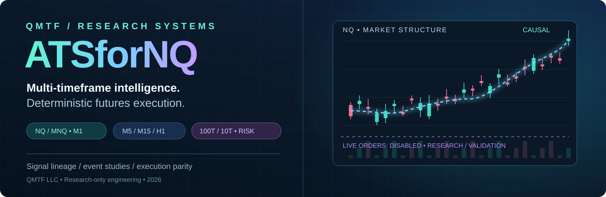
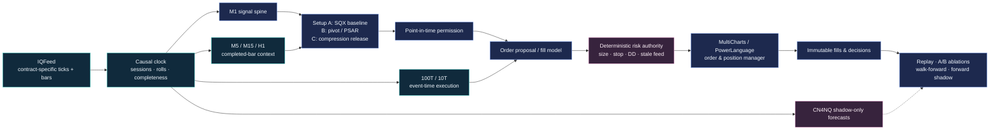
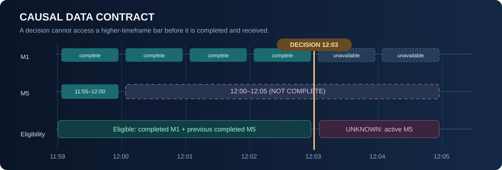

<!-- ATSforNQ | public technical overview | QMTF LLC -->
<div align="center">



# ATSforNQ
### Causal Multi-Timeframe Futures Research · Deterministic Execution · Statistical Validation

**A modular NQ/MNQ research program at the intersection of mathematical physics, market microstructure, quantitative finance, software verification, and machine learning.**


**QMTF LLC · November 2026 · Research specification v0.1**

</div>

> [!IMPORTANT]
> **This repository is a research and engineering workbench, not a live-trading product.** No validated autonomous execution or independently demonstrated deployable profit is claimed. The baseline backtest is **unreconciled**, optimization and newer setups are **planned**, and CN4NQ models have **no order authority**. Historical results are not a prediction of future performance.

---

## 01 · Scientific thesis

We treat a trading strategy as a **time-indexed, falsifiable decision system**, not a collection of visually appealing indicators.

The objective is to discover whether an observable market state at decision time `t` predicts a **positive, realizable economic outcome** after transaction costs, missed fills, execution latency, and drawdown constraints:

**Optimization objective**

$
(\theta^\ast,\pi^\ast) = \arg\max_{(\theta,\pi)\in\mathcal{F}} \mathbb{E}_{\mathrm{forward}}\left[\Pi_{\mathrm{net}}(\theta,\pi)\right]
$

The feasible set $\mathcal{F}$ requires **all four independent constraints**:

**Drawdown limit**

$
\mathrm{DD}(\theta,\pi) \le D_{\max}
$

**Per-trade risk budget**

$
\mathrm{Risk}_{\mathrm{trade}} \le R_{\max}
$

**No future or unavailable information**

$
T_{\mathrm{available}}(x) \le T_{\mathrm{decision}}
$

**Deterministic risk-safe execution policy**

$
\pi \in \Pi_{\mathrm{deterministic,safe}}
$

Here $\theta$ denotes signal parameters, $\pi$ denotes the execution/exit policy, and $\Pi_{\mathrm{net}}$ is net realized P&L. **Drawdown and stop constraints are policy limits, not mathematical guarantees**: gaps, rejections, and slippage can exceed a planned loss.

Our working sequence is deliberately **baseline → parity → risk → features → execution → independent setups → optional neural intelligence**. Every modification is an isolated experiment with a frozen comparator and a no-promotion outcome when evidence is insufficient.

### The system in one picture



**Decision authority:** Features may propose a trade; the risk engine may deny it. An optional AI component may explain or eventually veto under separate approval, but **may never authorize an unsafe order or relax deterministic controls**.

---

## 02 · Existing SQX 1.10.153: empirical starting point

| Benchmark property | Original strategy / uploaded MultiCharts report |
|:--|--:|
| Symbol / analysis interval | `@NQZ26` / 1-minute |
| Historical report | June–November 2026, approximately |
| Trades | **69** total: 34 long / 35 short |
| Reported winning fraction | **72.46%** |
| Reported net P&L | **+$56,868** |
| Reported profit factor | **2.97** |
| Reported maximum strategy drawdown | **$11,640** |
| Configured initial capital | **$10,000** |
| Original profit target | **365 ticks** |
| Original nominal time exit | **95 M1 bars** |
| Original close-relative stop coefficient | **6.8%** |
| Indicator-driven exit predicates | **None** — both `false` |

These are *historical report observations*, not a reproduced or forward-validated edge. **The reported drawdown exceeds the assumed starting capital.** A separate source-to-report reconciliation is the first blocking task: the trade ledger contains profits above the nominal 365-tick, one-NQ target, and the optional immediate-stop branch references an entry-price variable without a demonstrated assignment. Neither anomaly should be optimized away without explanation.

### Worked derivation A — the original signal equations

Let $C_t$ be the completed one-minute close, $E_t=\mathrm{EMA}_{20}(C)_t$, and $L^{(D-1)}$ / $H^{(D-1)}$ be the prior-day low / high returned by the platform functions. Bracket offsets are *source-code bar offsets*, not a claim about the platform's daily-boundary semantics.

**Step 1: derive the long and short activation predicates exactly as exported.**

For clarity, $\mathbf{1}[A]$ denotes the indicator of proposition $A$: it equals 1 when $A$ is true and 0 otherwise.

**Long entry**

$
B_{\mathrm{L}}(t) = \mathbf{1}\left[\mathrm{LowD}(1)[1] > \mathrm{EMA}_{20}(C)[3] \land \mathrm{LowD}(1) < \mathrm{EMA}_{20}(C)[2]\right]
$

**Short entry**

$
B_{\mathrm{S}}(t) = \mathbf{1}\left[\mathrm{HighD}(1)[1] < \mathrm{EMA}_{20}(C)[3] \land \mathrm{HighD}(1) > \mathrm{EMA}_{20}(C)[2]\right]
$

**Step 2: distinguish the signal from the executable order price.** Let $K_{j,t}$ denote `SQ_MTKeltnerChannel(20, 1.5, j)` evaluated on completed M1 bar $t$, and let $A_t$ denote `SQ_ATR(40)` on that bar. The selector $j$ is **0 on long** and **1 on short**; its exact internal channel semantics remain subject to library parity.

**Long buy-stop price**

$
P^{\mathrm{stop}}_{\mathrm{L},t} = \mathrm{RoundTick}\left(K_{0,t-2}+2.60\cdot A_{t-2}\right)
$

**Short sell-stop price**

$
P^{\mathrm{stop}}_{\mathrm{S},t} = \mathrm{RoundTick}\left(K_{1,t-2}-2.60\cdot A_{t-2}\right)
$

**Step 3: state the baseline execution contract.** A long `Buy Stop` or short `Sell Short Stop` is submitted for the **next bar** only when flat and when trading options permit new orders. The original PowerLanguage sets `IntrabarOrderGeneration = false`.

**Inference to test:** An ATR-displaced stop order can improve confirmation yet sacrifice entry price. A retest or event-time execution method may improve price, but can also increase missed fills. The experiment must count **all original opportunities**, not only its filled winners.

### Worked derivation B — NQ/MNQ tick economics

CME tick size is `\delta=0.25` Nasdaq-100 index points; one full NQ point is `$20` per contract, and one MNQ point is `$2` per contract.

**Step 1 — original fixed target in points:**

$$
\Delta P_{\mathrm{TP}}=365(0.25)=91.25\ \text{index points}.
$$

**Step 2 — gross value for one contract:**

$
V_{\mathrm{NQ}} = 91.25(20) = \$1{,}825
$

$
V_{\mathrm{MNQ}} = 91.25(2) = \$182.50
$

**Step 3 — trade expectancy from the reported aggregate (descriptive only):**

$$
\overline{\Pi}_{\mathrm{reported}}
=\frac{\$56{,}868}{69}
\approx \$824.17\ \text{per historical trade}.
$$

None of these computations accounts for additional slippage beyond the report assumptions or proves that an order could have been filled at the modeled price. This is exactly why trade-ledger parity precedes optimization.

---

## 03 · Causality: an engineering invariant, not a preference



### Worked derivation C — point-in-time admissibility

A feature derived from a bar `b` has at least three relevant timestamps: end/completion, local receipt, and decision.

**Step 1 — write the two necessary inequalities:**

$$
\boxed{
T_{\mathrm{complete}}(b)\le T_{\mathrm{decision}}
\quad\land\quad
T_{\mathrm{received}}(b)\le T_{\mathrm{decision}}.
}
$$

**Step 2 — evaluate a concrete timestamp example.** A decision at **12:03** can use a fully received M1 bar ending at **12:03** and an M5 bar ending at **12:00**. It **cannot** use the M5 bar ending at **12:05**, even though historical data files already contain that bar's eventual high, low, and close.

**Step 3 — propagate missingness instead of fabricating confidence:**

$$
S_j(t)\in
\{\mathrm{TRUE},\mathrm{FALSE},\mathrm{UNKNOWN}\},
\qquad
\mathrm{UNKNOWN}\not\Rightarrow\mathrm{ENTRY}.
$$

The clocks remain distinct: **M1 is the strategy/discovery spine**; M5/M15/H1 provide completed-bar context; 100-trade and 10-trade event bars are proposed execution-resolution streams. Event-time bars must be constructed from *actual contract-specific transactions*, never reconstructed by inventing intrabar prints from M1 OHLC.

This contract also applies to CME Globex reopen, Tokyo cash open, U.S. RTH, DST changes, futures rolls, holidays, and vendor data corrections. Session gates are scientific hypotheses to test, not permanent assumptions that Asia always selects a direction after a fixed number of minutes.

---

## 04 · Risk physics: scale, quantization, and monotone protection

Risk is enforced at three levels: **strategy geometry**, **account limits**, and **operational health**. A profitable signal never overrides a stop, margin constraint, order rejection policy, or stale-feed shutdown.

### Worked derivation D — a dollar risk budget in tick space

Let $q$ be the *integer number of contracts*, $v_{\mathrm{tick}}$ be USD per tick per contract, $n$ the stop distance in ticks, and $c$ the assumed round-trip cost.

$$
R_{\mathrm{modeled}}=q\,n\,v_{\mathrm{tick}}+c.
$$

**Step 1 — solve for the largest permissible tick distance under the model:**

$$
n_{\max}=
\left\lfloor
\frac{R_{\max}-c}{q\,v_{\mathrm{tick}}}
\right\rfloor.
$$

**Step 2 — illustrative one-NQ budget**, with $R_{\max}=\$500$, $q=1$, $v_{\mathrm{tick}}=\$5$, and $c=\$4$:

$$
n_{\max}
=\left\lfloor\frac{500-4}{1(5)}\right\rfloor
=\lfloor99.2\rfloor
=99\ \text{ticks}.
$$

**Step 3 — verify points and modeled dollars:**

$$
99(0.25)=24.75\ \text{points},
\qquad
99(5)+4=\boxed{\$499}.
$$

This is an **illustrative research risk budget**, *not* the original SQX 6.8% stop or a universal recommended stop. It assumes zero extra slippage and a stop fill at the planned price; **realized losses can exceed $499**.

### Worked derivation E — a true one-way ATR runner stop

The legacy stop is `EntryPrice \pm 0.068\,Close`. Because the close changes, that stop is **not guaranteed to ratchet protectively**.

For an experimental long runner with multiplier `k` and ATR `A_t`, use the recurrence

$$
\boxed{
S^{\mathrm L}_t
=\max\!\left(S^{\mathrm L}_{t-1},\,C_t-kA_t\right).
}
$$

For a short runner,

$$
\boxed{
S^{\mathrm S}_t
=\min\!\left(S^{\mathrm S}_{t-1},\,C_t+kA_t\right).
}
$$

**Step 1 — numerical long example:** $C_t=30{,}000$, $A_t=40$ points, $k=2$, old stop $S_{t-1}=29{,}900$.

$$
S_t=\max(29{,}900,\;30{,}000-2(40))
=\boxed{29{,}920}.
$$

**Step 2 — adverse next bar:** $C_{t+1}=29{,}980$ and $A_{t+1}=40$.

$$
S_{t+1}
=\max(29{,}920,\;29{,}980-80)
=\boxed{29{,}920}.
$$

The protected level does **not move backward**. Actual broker-side stops require additional price-validity, cancel/replace, fill, and outage handling; the recurrence is a research specification, not executable order-routing code.

**Runner design constraint:** One NQ contract cannot be divided into fractional core/runner legs. Compare an all-out fixed target against an all-out trail for single-contract research; test core/runner partial exits only with integer multi-contract or MNQ sizing and a new risk-equivalence analysis.

---

## 05 · Scientific significance ≠ profitable-looking history

We distinguish **market-structural significance** (a level, pivot, displacement, or confirmed release) from **statistical significance** (evidence that an improvement survives sampling uncertainty and search selection).

### Worked derivation F — paired, cost-adjusted incremental utility

For a session $d$, compute the return of the new policy and of the *frozen* baseline under the same opportunity/fee/fill convention:

$$
\Delta_d=\Pi_{d,\mathrm{new}}^{\mathrm{net}}
         -\Pi_{d,\mathrm{base}}^{\mathrm{net}}.
$$

For $D$ evaluation sessions,

$$
\widehat{\Delta}
=\frac{1}{D}\sum_{d=1}^{D}\Delta_d.
$$

**Step 1 — an arithmetic illustration, not project results:** three session differences of **−$20**, **+$60**, and **+$80** yield

$$
\widehat{\Delta}
=\frac{-20+60+80}{3}
=\boxed{\$40\text{ per session}}.
$$

**Step 2 — quantify uncertainty correctly:** resample *whole sessions or contiguous blocks* (not millions of autocorrelated M1 rows), creating bootstrap replicates $\widehat{\Delta}^{(b)}$.

$$
\mathrm{CI}_{0.95}
=\left[
Q_{0.025}\left(\{\widehat{\Delta}^{(b)}\}_{b=1}^{B}\right),
Q_{0.975}\left(\{\widehat{\Delta}^{(b)}\}_{b=1}^{B}\right)
\right].
$$

**Step 3 — decide conditionally:** a positive mean alone is insufficient. Require a predeclared uncertainty threshold, drawdown budget, forward-holdout performance, realistic fill model, and parameter-neighborhood stability. If the interval crosses zero, the correct decision may be **retain the baseline / collect more evidence**.

### Worked derivation G — multiple comparisons and selection bias

Suppose $m=100$ *independent* hypotheses are tested at nominal $\alpha=0.05$.

$
\Pr(\text{at least one false positive}) = 1-(1-\alpha)^m
$

$
1-(1-0.05)^{100} = 1-0.95^{100} \approx 0.994
$

Independence is an illustrative assumption; real strategy candidates are highly correlated. A conservative Bonferroni benchmark for family-wise error is

$$
\alpha_{\mathrm{per\ test}}=\frac{0.05}{100}=0.0005.
$$

This motivates candidate registries, trial accounting, correlation/overlap analysis, block-resampled significance, chronological splits, and **untouched future evaluation**, rather than selecting the maximum backtest net profit from thousands of parameter combinations.

**Predeclared objective vector:**

$$
\mathbf{J}(\theta)=
\left(
-\mathrm{NetExpectancy},
\mathrm{MaxDD},
\mathrm{IntradayDD},
\mathrm{LossTail},
\mathrm{SlippageSensitivity},
-\mathrm{Stability}
\right).
$$

We compare the Pareto frontier and hard gates; we do **not** collapse the entire research program into “Maximize Net Profit.”

---

## 06 · Entry families, runner geometry, and future CN4NQ

| Family | Candidate inputs | Primary falsifiable question |
|:--|:--|:--|
| **A · SQX baseline** | Previous-day H/L · EMA(20) · MT-Keltner(20, 1.5) · ATR(40) | Can we improve entry offsets and original exits without overfitting? |
| **B · Structure/pullback** | Causal pivots · PSAR sign/flip · VWAP / reclaim | Can we enter closer to a genuine turn without excessive initial heat? |
| **C · Compression/release** | ATR-normalized compression · breakout position · volume Z-score | Can we capture additional independent directional releases? |
| **D · Session-specific (optional)** | Globex reopen · Tokyo anchor · OR/IB acceptance · MTF slope | Does waiting for observable direction create measurable net uplift? |

PSAR polarity and all custom indicator names must have *platform-specific, parity-tested semantics*. The above are **candidate families**, not an implemented or validated indicator voting system.

### CN4NQ's GOLD geometry is a research label, not clairvoyance

The earlier CN4NQ v0.3.2.1 research contract defines a strict **retrospective** event class:

Define the Boolean gates for pivot proximity, runner magnitude, initial heat, and path quality:

$
I_{\mathrm{pivot},i} = \mathbf{1}\left[d_{\mathrm{pivot,bars},i}\le 3 \land d_{\mathrm{pivot,ticks},i}\le16\right]
$

$
I_{\mathrm{runner},i} = \mathbf{1}\left[\mathrm{RunnerTicks}_i\ge40\right]
$

$
I_{\mathrm{heat},i} = \mathbf{1}\left[\mathrm{MAE}_{\mathrm{before\,MFE},i}\le12\right]
$

$
I_{\mathrm{path},i} = \mathbf{1}\left[\mathrm{Slope}_{\mathrm{ticks/bar},i}\ge1 \land R_i^2\ge0.45\right]
$

The retrospective GOLD label is their conjunction:

$
G_i = I_{\mathrm{pivot},i} I_{\mathrm{runner},i} I_{\mathrm{heat},i} I_{\mathrm{path},i}
$

The labels measure the **direction, proximity to launch, favorable excursion, initial adverse heat, and trend coherence** of an observed path. A 2/2 pivot needs two *future* bars to be confirmed (3/3 needs three); unconfirmed hindsight pivots and post-entry excursion are **never** permissible contemporaneous trade features. These thresholds characterize a historical labeling configuration, not a new recommended stop or a validated live predictor.

Future CN4NQ integration follows a separate sequence: **causal feature parity → frozen model → shadow forecasts → calibration → incremental ablation → explicit promotion gate**. Local Qwen/LLM output may assist explanation and hypothesis generation; it never owns the order path.

---

## 07 · Implementation synopsis: ten gated phases

| Phase | Research engineering deliverable | Exit gate |
|:--|:--|:--|
| **P0 · Governance** | Source register, immutable original artifacts, SHA-256 manifests, rights policy | **G0** evidence & lineage complete |
| **P1 · Baseline parity** | Reconcile each SQX/MC entry, exit, fill, cost, and report anomaly | **G1** exact or fully explained trade parity |
| **P2 · Parameter refactor** | Expose per-side EMA/Keltner/ATR/TP/SL/time parameters; defaults unchanged | **G2** zero unintended strategy drift |
| **P3 · Controlled optimization** | Bounded parameter search, drawdown-aware Pareto ranking, forward split | **G3** robust held-out improvement |
| **P4 · Risk + runners** | Immediate hard stops, BE, ATR/PSAR trails, time and failure exits | **G4** deterministic invariants + net uplift |
| **P5 · MTF + sessions** | Completed H1/M15/M5, Asia direction-establishment experiments | **G5** incremental session/MTF evidence |
| **P6 · 100T / 10T** | Tick archive parity, event bars, realistic alternative fills | **G6** improved outcomes incl. missed orders |
| **P7 · Independent setups** | B/C/D family additions, attribution, overlap and significance tests | **G7** nonredundant, held-out contribution |
| **P8 · CN4NQ shadow** | Frozen inference interface, read-only telemetry, calibration | **G8** zero model authority; validated shadow |
| **P9 · Controlled promotion** | MultiCharts integration, negative-path tests, restart and forward soak | **G9** independent approval or remain simulated |

This order deliberately prevents an attractive result at `P7` from hiding a broken timestamp or incorrect fill at `P1`.

### Development contracts for software and ML engineers

- **Determinism:** versioned parameters and schema; pinned contract/roll calendar; replay equivalence; immutable decision IDs.
- **Causality:** completed **and received** bars only; missing, stale or contradictory evidence resolves to **NO ENTRY**.
- **Semantic parity:** original StrategyQuant, MultiCharts PowerLanguage, Python replay, and any PB2/CN4NQ adapters must agree before shared signal authority.
- **Safe failure:** deterministic risk is outside model control; reject stale feeds, duplicate orders, unsupported sizes, and missing protective stops.
- **Traceability:** record data hashes, Git commit, config hash, model version, signal activation, proposed/actual order, fill and exit reason.
- **Scientific honesty:** separate discovery, adaptive validation, locked OOS, and prospective forward evidence; track all tried hypotheses.
- **Scope discipline:** futures-only NQ/MNQ. Do not silently substitute SPY/options logic, continuous futures for tradable contracts, or MNQ tick-volume features for NQ tick-volume features.

### Immediate research sprint

```text
1. Freeze original SQX source, XML, workbook and configuration locally.
2. Export and reconcile all 69 baseline trades.
3. Resolve TP > 365-tick discrepancy and the IntPriceLevel stop reference.
4. Specify IQFeed/MC clock, rollover and cost/fill semantics.
5. Copy the baseline; expose inputs with all new features disabled.
6. Run default-parameter parity and record a signed G1/G2 decision.
7. Only then begin controlled entry, stop, and runner ablations.
```

The comprehensive local planning documents are `tasks.md` (P0–P9 task register) and `IMPLEMENTATION_PLAN.md` (design, experiment and validation contract). They are **not yet part of this public repository**; publication requires a separate review and commit.

---

## 08 · Public repository boundaries

This public repository intentionally excludes **licensed IQFeed observations**, raw/identifiable account and trading reports, generated SQX proprietary strategy exports, credentials, vendor assets with unresolved rights, private research checkpoints, and large model weights. Technical descriptions and illustrative calculations do **not** confer rights to the underlying datasets, models or third-party source code.

| Area | Intended implementation | Current public status |
|:--|:--|:--|
| Graphic research overview | SVG assets in `docs/assets/` | **Present** |
| Architecture and mathematical contracts | This README | **Present** |
| PowerLanguage strategy modules | `powerlanguage/` | Planned |
| Deterministic Python research engine | `python/qmtf_ats/` | Planned |
| Test / parity harnesses | `tests/`, `scripts/` | Planned |
| Source and experiment manifests | `config/`, `experiments/` | Planned |
| Controlled reports / gates | `reports/` | Planned |

### Research provenance

The engineering roadmap draws from the SQX 1.10.153 source and the November 2026 MultiCharts workbook, earlier Build Alpha/PB2 research, and the related [CondorNet-4-Futures](https://github.com/trextrader/CondorNet-4-Futures), [PB2Native](https://github.com/trextrader/dr-quantor-pb2native), and [NQ-LLM-Lab](https://github.com/trextrader/NQ-LLM-Lab) programs. Their historical performance statistics and model-status statements should be interpreted only within their own research/validation contracts.

---

<div align="center">

**Market hypotheses are proposals. Causal evidence is the constraint. Realized execution is the test.**

<sub>Copyright © 2026 QMTF LLC. All rights reserved. No open-source license has been granted for this repository.</sub>

</div>
