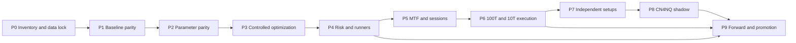

# QMTF NQ/MNQ Multi-Timeframe ATS — Master Tasks

**Project:** ATS for NQ & MNQ MC  
**Working name:** QMTF MTF-ATS  
**Document:** `tasks.md`  
**Version:** 0.1.0 (planning baseline)  
**Prepared:** 2026-11-10  
**Scope:** MultiCharts PowerLanguage/TradeStation-compatible EasyLanguage research, IQFeed NQ/MNQ data, optional Python research and native telemetry, and future read-only CN4NQ intelligence integration.  
**Companion:** [`IMPLEMENTATION_PLAN.md`](IMPLEMENTATION_PLAN.md)  
**Overall state:** DESIGN BASELINE / NOT APPROVED FOR AUTONOMOUS LIVE TRADING.

## How to use this checklist

- `[ ]` = not yet demonstrated complete; do not infer implementation from a previous discussion.
- Mark complete only after saving **evidence**: commit, input hashes, experiment ID, test output, reviewer, and date in `experiments/registry.csv` or corresponding manifest.
- Status labels: **BASELINE** (freeze/parity), **RETAIN** (existing component), **OPTIMIZE** (same logic, new parameters), **EXPERIMENT** (new hypothesis), **HOLD** (unvalidated/blocked), **REJECT** (not promoted; do not delete archives).
- Owners are proposed roles, not personnel assignments: **R** research/quant, **D** engineering, **V** independent validation, **O** operations/risk. One individual may hold several roles, but validation evidence must remain separately recorded.
- All performance numbers are **historical research observations**, never guarantees. Any proposed threshold or default below is a test hypothesis unless explicitly sourced from the strategy.
- Historical references and tentative repo paths must be checked against the current local checkout before they are treated as authoritative.

## Decision register — initial recommendation

| Source or feature | Status | Immediate handling | Primary reason |
|---|---|---|---|
| SQX v1.10.153 source + November 10 MultiCharts export | **BASELINE** | Freeze, investigate discrepancy, reproduce | Foundation candidate; trade parity not yet proven |
| IQFeed contract-specific tick / M1, M5, M15, H1 | **RETAIN** | Causal clock + rollover audit | Reusable evidence/data foundation |
| Previous-day low/high, EMA20, MT Keltner20/1.5, ATR40 | **RETAIN / OPTIMIZE** | Exact function parity, then narrow parameter study | Existing signal core |
| PSAR (`ParbolSAR` Build Alpha wrapper) | **EXPERIMENT** | Preserve `+1` bullish / `-1` bearish semantics, verify native implementation | Candidate timing and exit signal |
| 100-trade and 10-trade tick-count bars | **EXPERIMENT** | Timestamp/event-order verification; simulation only | Lower-timeframe entry and exit timing |
| Asia directional-establishment gate | **EXPERIMENT** | Separate CME Globex restart from Tokyo cash open | Session observation, not assumed alpha |
| PB2 Desk Sync v7.2c | **RETAIN IDEAS / HOLD REPLAY** | Adapt session/regime/early-entry concepts only after parity | Native replay MTF mismatch unresolved |
| Build Alpha / APA entry-exit predicate families | **EXPERIMENT** | Canonicalize, audit aliases, isolate candidate contributions | Research search assets, not approved orders |
| ChaosHunter / Adaptrade expressions | **EXPERIMENT** | Semantic/units/correlation audit first | Potential independent predicates |
| CN4NQ causal alignment, registry, activation, pivot/GOLD methodology | **RETAIN** | Reuse as research methodology | Has explicit provenance and anti-lookahead rules |
| CN4NQ neural outputs / F0-P / specialist models | **HOLD** | Offline/shadow only after calibration | No independently validated deployment authority |
| Qwen / local LLM | **REJECT FOR ORDER PATH** | Advisory research only | No deterministic execution authority |
| RockStar and Unified Kalman legacy implementation | **HOLD / REJECT DEFAULT** | No production import without independent retest | Earlier ablation/removal concerns |
| Options-only signals or forward-looking labels | **REJECT DEFAULT** | Separate research only | Not NQ/MNQ causal futures predictors |
| CondorSquawk | **HOLD AS CONTEXT** | Tag upcoming events/news; avoid unverified directional orders | Event risk not established alpha |

---

## P0 — Governance, source inventory, and reproducibility (**BLOCKS ALL OTHER PHASES**)

- [ ] **P0-001 [R/D]** Create isolated development branch/tag and immutable `baseline/` directory; never overwrite original SQX strategy.
- [ ] **P0-002 [D]** Inventory exact EasyLanguage `.eld/.els/.txt` file versions, compilation outputs, MultiCharts version, instrument, chart compression, contract, sessions, timezone, and platform build.
- [ ] **P0-003 [D]** Hash uploaded SQX source and workbook (SHA-256); copy originals to read-only evidence storage and register source origin.
- [ ] **P0-004 [R]** Inventory strategy prior-art repositories and local sources: `MC_ATS`, `CondorNet-4-Futures`, `NQ-LLM-Lab`, `dr-quantor-pb2native`, plus retained PB2 Pine and SQX exports.
- [ ] **P0-005 [R]** Create `docs/RESEARCH_SOURCE_REGISTER.md` with project, artifact, version, code location, timestamp, data split, status, claimed feature, and validation evidence.
- [ ] **P0-006 [R]** Record candidate disposition as RETAIN / OPTIMIZE / EXPERIMENT / HOLD / REJECT and explicit rationale; never silently delete a rejected source.
- [ ] **P0-007 [D]** Create experiment manifest schema covering git SHA, exact strategy SHA, data hashes, optimizer settings, platform build, code paths, and output hashes.
- [ ] **P0-008 [D]** Establish reproducible directory layout and Windows PowerShell entry scripts; default no virtual-environment requirement unless a particular dependency forces one.
- [ ] **P0-009 [O]** Document account-by-account rules: allowed instruments, max size, daily loss, trailing drawdown, session restrictions, forced liquidation, news restrictions and simulation/live permissions.
- [ ] **P0-010 [V]** Define independent chronological train/validation/test and forward-shadow periods for **this** strategy, recording that the uploaded report's 2026 dates are already exposed for research.
- [ ] **P0-011 [V]** Freeze OOS governance: no resampling, reselection, threshold tuning, or new candidate search using sealed results.
- [ ] **P0-012 [D]** Create a release/go-no-go rubric and explicit fail-closed conditions; no automatic execution during P0–P7.

**Gate G0:** Evidence inventory is complete, original artifacts are frozen, account restrictions are known, and dataset access policy is documented. **Blocker:** raw local workstation artifacts not accessible from this plan alone.

## P1 — Exact source-to-backtest reconciliation (**HIGHEST PRIORITY**)

- [ ] **P1-001 [R]** Capture workbook summary: 69 total trades (34 long / 35 short), net $56,868, PF 2.9726, max strategy DD $11,640, initial capital $10,000, and published cost settings.
- [ ] **P1-002 [R]** Record workbook instrument `@NQZ26`, one-minute compression, Bar Magnifier disabled, Fixed $2/trade commission, and $1/trade slippage field; do not presume execution cost interpretation without checking trades.
- [ ] **P1-003 [D]** Rebuild SQX strategy with source defaults unchanged: LowD/HighD previous-day predicate, EMA20, MTKeltner(20,1.5), ATR40, 365-tick target, close-relative 6.8% stop, 95-bar time exit.
- [ ] **P1-004 [D]** Confirm each `SQ_` function's installed definitions, output-selector meaning (`MTKeltner` 0 versus 1), scaling, rounding and warmup behavior.
- [ ] **P1-005 [D]** Audit `LowD(1)[1]` and `HighD(1)[1]` around exchange session boundaries, holiday halves, time zones and data rollover.
- [ ] **P1-006 [D]** Investigate `IntPriceLevel` versus `IntPriceLevelLong/Short`; the initial-stop branch currently references a variable initialized to zero. Do not enable it until resolved.
- [ ] **P1-007 [D]** Verify order duration and cancellation: when a stop entry remains pending, whether it can trigger beyond the intended signal, and when it is replaced/cancelled.
- [ ] **P1-008 [R/V]** Reconcile reported winning fills greater than nominal one-NQ 365-tick/$1,825 gross target; inspect actual orders, strategy revision, data/commission/adjustments and exits.
- [ ] **P1-009 [D]** Re-run the untouched strategy using the exact chart/session data, cost assumptions and contract settings.
- [ ] **P1-010 [V]** Join original and reconstructed trades on side, entry timestamp, exit timestamp, entry/exit price, order type and quantity.
- [ ] **P1-011 [V]** Produce discrepancy log for every mismatch: missing trade, shifted bar, fill price, target, stop, signal name, costs, rollover, session or software version.
- [ ] **P1-012 [D]** Audit duplicate/competing orders, `This Bar On Close` versus next-bar semantics, chart reload effects, stop order precedence and IOG=false.
- [ ] **P1-013 [D/V]** Test the stop/target execution at higher temporal resolution with bid/ask-aware data if available; do not use M1 OHLC as an assumed intrabar path.
- [ ] **P1-014 [V]** Export baseline per-trade MFE/MAE, exit classification, holding bars, entry lag, current stop levels and session labels.
- [ ] **P1-015 [V]** Produce `reports/G1_BASELINE_PARITY.md` with exact result, remaining unexplained differences, and signed research decision.

**Gate G1:** Prefer exact trade-by-trade reproduction. If exact parity is infeasible due to platform/provider differences, document and justify every discrepancy; no optimization claims until the comparison contract is frozen.

## P2 — Parameterization without strategy drift

- [ ] **P2-001 [D]** Implement separate and namespaced LONG / SHORT / COMMON input groups in a *copy* of the code.
- [ ] **P2-002 [D]** Expose the current EMA comparison period (20), shifts (3/2), and previous-day lookup period (1) without changing expression evaluation order.
- [ ] **P2-003 [D]** Expose MTKeltner period (20), multiplier (1.5), selector (0 long / 1 short), and shift (2).
- [ ] **P2-004 [D]** Expose ATR period (40), multiplier (2.60) and shift (2) by trade side.
- [ ] **P2-005 [D]** Expose stop-entry type, entry level rounding, signal expiry and max-distance acceptance as separate execution parameters.
- [ ] **P2-006 [D]** Expose per-side TP=365 ticks, close-relative SL=6.8%, and maximum-hold=95 bars; retain original modes as `LEGACY` for parity tests.
- [ ] **P2-007 [D]** Preserve general trading inputs (weekday/session flags, Friday exit, sizes, capital, min/max SL/PT) with backward-compatible defaults.
- [ ] **P2-008 [D]** Add explicit enabled/disabled feature flags, defaulting **off** for every new rule, stop mode, session gate, indicator exit and tick-execution feature.
- [ ] **P2-009 [D]** Add input validation, tick/point/dollar unit checks, minimum quantity, directional semantics and incompatible-mode guards.
- [ ] **P2-010 [V]** Run default-configuration regression against G1; no meaningful trade drift allowed.
- [ ] **P2-011 [D]** Check signal and order tags preserve unique long/short/setup provenance for future attribution.
- [ ] **P2-012 [V]** Publish `config/baseline_v110153.yaml` (metadata) and `reports/G2_PARAMETER_PARITY.md`.

**Gate G2:** Current settings replicate the reconciled baseline when all new features are disabled.

## P3 — Baseline diagnostic research and controlled optimization

- [ ] **P3-001 [R]** Compute trade-by-trade entry delay versus next known historical local extreme **for evaluation only**, never as a tradable lookahead input.
- [ ] **P3-002 [R]** Compute entry adverse/favorable excursions and opportunity capture by session, direction, signal, volatility quintile and trend regime.
- [ ] **P3-003 [R]** Analyze all 19 historic losing trades, specifically whether 95-bar exits or stop rules account for their outcomes; verify against actual ledger.
- [ ] **P3-004 [R]** Replay after each original exit for 15/30/60/120 minutes; quantify *counterfactual* continuation MFE, reversal MAE and trailing exit opportunities with tradeable timestamp rules.
- [ ] **P3-005 [R]** Split long/short sensitivity and distributional stability before optimizing a common parameter set.
- [ ] **P3-006 [V]** Write IS/validation/forward chronology and purging/embargo rules where holding horizons overlap fold boundaries.
- [ ] **P3-007 [R]** Optimize first a **small, predeclared** grid: EMA; Keltner/ATR periods and entry offset; do not change entries and exits at once.
- [ ] **P3-008 [R]** Optimize stops and exits separately: TP ticks, initial hard stop (ticks or ATR), holding period, session liquidation.
- [ ] **P3-009 [R]** Compare exhaustive search for small grids versus genetic search for broader grids; record *all* attempted combinations for multiple-test accounting.
- [ ] **P3-010 [R]** Rank on cost-adjusted expectancy, max intraday/strategy DD, stability, capacity, trade count, net/DD, PF and drawdown duration—not Max Net Profit only.
- [ ] **P3-011 [V]** Conduct neighboring-parameter sensitivity analysis and report flatness/fragility of objective surface.
- [ ] **P3-012 [V]** Re-run finalists across alternative slippage assumptions, spread regimes and rolls.
- [ ] **P3-013 [V]** Use day/session-block bootstrap uncertainty and multiple-comparison correction/deflated Sharpe when applicable.
- [ ] **P3-014 [V]** Maintain untouched forward holdout and record research trials; refuse claims from repeated test-set tuning.
- [ ] **P3-015 [R/V]** Save Pareto frontier and rejected candidates with reproducible manifests.

**Gate G3:** At least one adequately sampled configuration passes predeclared uncertainty, drawdown, robustness and forward-holdout gates; otherwise retain baseline and do not promote optimization.

## P4 — Deterministic risk management and runner exits

- [ ] **P4-001 [O/D]** Replace the legacy 6.8%-of-Close stop **for new experimental modes** with an immediately active, bounded protective stop; preserve `LEGACY` only for historical parity.
- [ ] **P4-002 [D]** Implement tick-based, ATR-multiple and structure-based initial stops as mutually explicit modes, with maximum permitted dollar risk.
- [ ] **P4-003 [D]** Handle initial stop after fill, rejected stop, partial fills, disconnections, restarts and stop/target race conditions; prefer fail-closed flatten/cancel policy.
- [ ] **P4-004 [D]** Add per-side fixed TP, ATR target, R-multiple target, and no-fixed-TP runner mode, all disabled except one configured policy.
- [ ] **P4-005 [D]** Implement monotone stop ratchet for longs and shorts; unit-test that protection never loosens absent explicit emergency repair.
- [ ] **P4-006 [D]** Implement break-even trigger + costs buffer and no premature BE mode.
- [ ] **P4-007 [D]** Implement ATR trailing, PSAR trailing, previous-pivot/structure trailing and short-term slope-decay exit, as separately testable families.
- [ ] **P4-008 [D]** Implement runner exit reason and priority (catastrophic stop > risk/session shutdown > stop/target > reversal/decay > time exit).
- [ ] **P4-009 [D]** For fixed **1 NQ**, compare all-out fixed TP versus all-out trailing runner; do not pretend a single contract can partially exit.
- [ ] **P4-010 [D]** For multi-MNQ sizing, introduce optional core-plus-runner legs with explicit size and order linkage; do not infer NQ and MNQ tick-volume equivalence.
- [ ] **P4-011 [R]** Measure counterfactual winner capture and stopped-trade heat; include giveback and MFE after original exit.
- [ ] **P4-012 [V]** Stress trailing stop under gap, spread widening, news whipsaw, platform disconnect and nonfill scenarios.
- [ ] **P4-013 [V]** Record independent ablation results for each exit feature and combined exits.
- [ ] **P4-014 [O]** Enforce account-specific trailing drawdown, max daily loss, consecutive-loss pause, max positions, margin and allowed hours **outside** any optional strategy logic.
- [ ] **P4-015 [V]** Deliver `reports/G4_RISK_AND_RUNNERS.md` with unit tests and promotion/no-promotion ruling.

**Gate G4:** Risk controls are deterministic, no stop loosening is possible, and adjusted runner expectancy exceeds its own control with acceptable adverse risk; otherwise do not add runner modes.

## P5 — Causal multi-timeframe and session intelligence

- [ ] **P5-001 [D]** Implement completed-bar-only H1, M15 and M5 context joins to M1; source completion and receipt time must precede decision time.
- [ ] **P5-002 [D]** Enforce canonical exchange calendar, CME Globex trading session, holiday early closes, trading dates and DST-aware time zones.
- [ ] **P5-003 [R]** Measure M5/M15/H1 EMA slopes, directional agreement, price structure and volatility; distinguish filter versus score.
- [ ] **P5-004 [R]** Evaluate ADX/DMI, slope persistence/R² and volatility regimes as **independent candidates**, not mandatory indicator stacks.
- [ ] **P5-005 [D/R]** Add prior-day, overnight/Asia range, VWAP/AVWAP and relevant significant levels with provenance and point-in-time calculation.
- [ ] **P5-006 [D]** Define distinct `GLOBEX_REOPEN`, `TOKYO_CASH_OPEN` and other session anchors using a timezone-aware calendar; never hardcode a single Mountain Time offset.
- [ ] **P5-007 [R]** Formalize Asia directional-establishment hypotheses: opening-range break + acceptance, trend/slope persistence, VWAP displacement, realized volatility and invalidation.
- [ ] **P5-008 [R]** Compare no-wait, 3/5/10/15/30-minute waits and event-based waits out of sample; optimize only on designated development splits.
- [ ] **P5-009 [D]** Include `NO_TRADE`, `INDETERMINATE`, `LONG_BIAS` and `SHORT_BIAS` market states with conflict/unknown handling.
- [ ] **P5-010 [V]** Verify each session/filter feature adds incremental predictive/economic information beyond base M1 trigger.
- [ ] **P5-011 [V]** Perform timezone-boundary and bar-completion nonrepainting tests for every MTF feature.
- [ ] **P5-012 [V]** Publish `reports/G5_MTF_SESSION_ABLATION.md`.

**Gate G5:** MTF/session additions improve held-out risk-adjusted results or are retired; direction-establishment remains a tested hypothesis, not a universal rule.

## P6 — Entry/exit execution refinement: M1 → 100T → optional 10T

- [ ] **P6-001 [D]** Verify IQFeed contract-specific raw tick archive: price, size, vendor/exchange timestamps, arrival timestamps, ordering, corrections and duplicates.
- [ ] **P6-002 [D]** Build deterministic event bars for 100 trades and 10 trades (and optional 15-second bars) with manifests; define whether tick bars count prints, aggregated trades or price changes.
- [ ] **P6-003 [V]** Confirm no synthetic tick stream is fabricated from M1 bars and no future event is used at a decision instant.
- [ ] **P6-004 [D]** Maintain M1 as authoritative signal clock; use lower timeframe only for execution if higher-level setup is already authorized.
- [ ] **P6-005 [R]** Study pending buy/sell stops versus limit-on-pullback, limit/stop hybrids and retest execution; include missed fills and adverse selection.
- [ ] **P6-006 [R]** Candidate 100T long trigger: local higher low/reclaim/PSAR shift with M1-approved long bias; symmetric short trigger.
- [ ] **P6-007 [R]** Test 10T only where event density and spread support it; include a guard that skips low-liquidity or excessively noisy intervals.
- [ ] **P6-008 [D]** Define bounded entry timer, max chase distance, cancellation, signal expiry and one-order-per-activation policy.
- [ ] **P6-009 [R]** Track signal time, earliest executable time, entry price, time-to-fill, fill rate, market slippage, alpha decay and rejected/missed order opportunity.
- [ ] **P6-010 [V]** Compare M1-only, M1+100T, M1+10T and hierarchical M1+100T+10T using the **same signal activations**.
- [ ] **P6-011 [V]** Test genuine bid/ask/spread and queue assumptions; do not claim fills at local turning points because the hindsight pivot is known.
- [ ] **P6-012 [V]** Publish `reports/G6_EVENT_EXECUTION.md` with cost-adjusted fills and paired comparisons.

**Gate G6:** Improvement is measured by *realizable* net expectancy per original opportunity (including misses), not cherry-picked price improvement on filled trades.

## P7 — Independent entry setups and significance research

- [ ] **P7-001 [R]** Define `SetupA_SQX_Core` from the parity-locked entry logic and only accepted modifications.
- [ ] **P7-002 [R]** Define `SetupB_PivotPullback` as a hypothesis using causal structure, VWAP/retest, price action, and PSAR **with confirmed directional semantics**.
- [ ] **P7-003 [R]** Define `SetupC_CompressionRelease` from CN4NQ compression, breakout, participation and trend-alignment candidate predicates.
- [ ] **P7-004 [R]** Define optional `SetupD_SessionContinuation` using Asia directional establishment and opening-range continuation/retest; do not add until A–C attribution is clean.
- [ ] **P7-005 [D]** Import selected Build Alpha, ChaosHunter, StrategyQuant and Adaptrade predicates with original lineage, role, source, units and alias status.
- [ ] **P7-006 [D]** Deduplicate logically identical/complementary predicates and identify highly overlapping activation-event masks.
- [ ] **P7-007 [D]** Preserve `TRUE/FALSE/UNKNOWN`, FALSE→TRUE activation semantics, timestamp, source and side for every predicate.
- [ ] **P7-008 [R]** Distinguish statistical significance (sampling evidence) from price-level significance (structure/volatility/volume) and define both precisely.
- [ ] **P7-009 [R]** Use retrospective GOLD labels (≥40 ticks runner, ≤12 ticks MAE-before-MFE, near-pivot geometry, slope/R² gates) for *research outcomes only*, not live entry gates.
- [ ] **P7-010 [V]** Test pre-entry predictive utility of candidate signals for GOLD/runner/early-turn events without future-information leakage.
- [ ] **P7-011 [V]** Apply blocked/bootstrap uncertainty, multiple-comparison correction, conditional performance analysis and calibrated abstention.
- [ ] **P7-012 [R]** Build standalone backtests A, B, C, then A+B, A+C, B+C, A+B+C with identical risk and cost assumptions.
- [ ] **P7-013 [R]** Quantify signal collision, long/short disagreement, setup priority, allowed concurrent positions, covariance and portfolio drawdown.
- [ ] **P7-014 [D]** Implement setup-specific entry/exit order names, cooldowns, risk allocation and one shared position manager.
- [ ] **P7-015 [V]** Retire any setup with negative incremental net expectancy, unstable parameters or materially worse drawdown absent compensating benefit.
- [ ] **P7-016 [V]** Publish `reports/G7_MODULAR_SETUP_ABLATION.md` and a source-level retain/reject list.

**Gate G7:** Every active setup has standalone evidence and positive—or clearly risk-diversifying—incremental value in the combined system, with no lookahead.

## P8 — CN4NQ integration and forward-shadow learning (**NO MODEL-ORDER AUTHORITY**)

- [ ] **P8-001 [R/D]** Compare the current `CondorNet-4-Futures` and `NQ-LLM-Lab` branches, source manifests, feature schema and formal model status before selecting integration contract.
- [ ] **P8-002 [D]** Reuse deterministic data/schema alignment, signal lineage and validated market-state features; keep differences in clock units, scaling and normalization explicit.
- [ ] **P8-003 [D]** Define read-only model input/output API: timestamp, stale flag, direction, regime, continuation, reversal hazard, runner potential, uncertainty and `NO_ENTRY`.
- [ ] **P8-004 [V]** Require reproducible model checkpoint, training split, calibration, real-time latency, parity and locked OOS results.
- [ ] **P8-005 [D]** Implement model timeout, stale data, disagreement, missing feature, failed checksum and crash as fail-closed abstention.
- [ ] **P8-006 [R]** Run shadow experiments: core ATS unchanged versus CN4NQ as veto only versus confidence/risk-sizing advisory.
- [ ] **P8-007 [V]** Evaluate adverse-veto costs (good trades suppressed), expected value, sample coverage, calibration, drawdown and long/short parity.
- [ ] **P8-008 [D]** Keep Qwen/LLM advisory outside order routing; log explanations without authorizing trades, moving stops or changing risk caps.
- [ ] **P8-009 [V]** Ensure previously sealed CN4NQ 2026 evaluation material is not repurposed as untouched data after being used for this new ATS design.
- [ ] **P8-010 [O/V]** Publish `reports/G8_CN4NQ_SHADOW.md` and explicitly approve or reject incremental model inputs after controlled forward observation.

**Gate G8:** CN4NQ is optional and cannot modify the production order path until all calibration, deterministic safety, cost and independent forward gates pass.

## P9 — MultiCharts integration, testing and controlled promotion

- [ ] **P9-001 [D]** Freeze PowerLanguage compilation target, MultiCharts version, runtime account profile and instrument mapping NQ/MNQ.
- [ ] **P9-002 [D]** Reuse native CN4F bridge/monitor **only after** source-level review, version matching and standalone fail-safe tests.
- [ ] **P9-003 [D]** Implement immutable decision/event journals with source-time, receipt-time, calculation-time, order-time, fills, order IDs and account risk state.
- [ ] **P9-004 [D]** Replay random, trending, rangebound, low-liquidity, Asia-session, RTH-open, CPI/FOMC and rollover windows.
- [ ] **P9-005 [V]** Run deterministic reference-data parity in Python vs PowerLanguage for all promoted indicators and setups.
- [ ] **P9-006 [V]** Run property tests: no lookahead, no duplicate entry, no widening trailing stops, no over-sizing, no unauthorized overnight exposure.
- [ ] **P9-007 [O/V]** Test stale quote, feed silence, broker disconnect, rejected stop, reconnect, duplicate fill and partially filled bracket recovery.
- [ ] **P9-008 [O]** Confirm NQ/MNQ contract multiplier/tick ($20/$2 per point; $5/$0.50 per 0.25 tick) and broker-specific fees/margins.
- [ ] **P9-009 [V]** Run forward paper/simulation on an unchanged frozen release; measure net performance, slippage and latency.
- [ ] **P9-010 [O]** Confirm account-rule and emergency-stop acceptance; keep deployment to live off by default.
- [ ] **P9-011 [O/V]** Require explicit manual signoff for micro-live canary; do not infer permission from a successful backtest.
- [ ] **P9-012 [D]** Implement rollback to last signed version, emergency flatten/cancel, and failure incident playbooks.
- [ ] **P9-013 [V]** Publish independent post-promotion monitoring and drift triggers; changes require new manifests/version and retesting.

**Gate G9:** Independently approved promotion only; otherwise simulation/shadow remains the highest authorized deployment state.

---

## Cross-cutting validation matrix

| Test family | Required proof | Stage |
|---|---|---|
| Source identity | SHA-256, git SHA, exact parameter file | P0–P2 |
| Trade parity | Entry/exit/price/side/order/cost comparison | P1–P2 |
| Causality | `T_complete ≤ T_decision` and `T_received ≤ T_decision`; future pivots remain labels | P0–P9 |
| Indicator parity | Multicharts vs reference Python/Pine where imported | P2/P5/P7/P9 |
| Historical integrity | Split discipline, purge/embargo, rollover normalization | P0/P3/P9 |
| Statistical evidence | Cost-adjusted expectancy, confidence, trials count, multiplicity | P3/P7/P8 |
| Entry precision | Paired fill quality **including missed trades** | P6 |
| Exits/runners | Counterfactual post-exit replay and realized protective stop behavior | P4 |
| Risk | Account limits and recovery from all failure cases | P4/P9 |
| Combination | A/B/C ablation, overlap, covariance, portfolio drawdown | P7 |
| Deployment | Frozen simulation-forward then explicit manual promotion | P9 |

## Milestones and dependencies



The arrows describe the required **release sequence**, not a prohibition on parallel offline exploratory coding. Each gate must be recorded before promotion of downstream behavior.

## Immediate sprint — start here

1. **Freeze** untouched source and report, build source provenance manifest (P0-001–003).
2. **Resolve** why the workbook contains gains above the nominal 365-tick one-contract profit target, and why initial-stop code references `IntPriceLevel` (P1-006/P1-008).
3. **Reconcile** trade-level fills and strategy settings on the exact NQZ26 M1 contract (P1-009–015).
4. **Parameterize** without modifying semantics and rerun identical baseline (P2-001–012).
5. **Measure** 19 losers and post-exit continuation to decide whether SL, time exit or runner trials are highest-value (P3-003/P3-004).
6. **Only then** begin controlled exit/runner and entry-parameter studies.

## Minimum artifact set for every experiment

```text
experiments/<exp_id>/
  manifest.json                 # commit, hashes, splits, metrics, trial count
  config.yaml                   # all defaults and override parameters
  trades.csv                    # each fill, side, order ID, setup ID, costs
  signal_events.parquet         # point-in-time indicator states and activation
  metrics.json                  # gross/net, PF, expectancy, DD, session breakdown
  robustness.json               # block-bootstrap, parameter neighborhood, stress
  decision.md                   # promote / revise / reject + independent reviewer
```

## Definition of done

- [ ] Original historical benchmark remains reproducible and unmodified.
- [ ] All promoted feature inputs have correct units, causal timing and parity evidence.
- [ ] Each independent trade setup and exit feature has controlled standalone/combined ablation evidence.
- [ ] Transaction costs, missed fills and account constraints are included.
- [ ] A genuinely unseen forward evaluation has been completed without adaptive reselection.
- [ ] Deterministic safety controls have passed failure/restart tests.
- [ ] Any live rollout, if authorized, is expressly approved and reversible.

**Safety boundary:** Successful research, optimization, simulation or shadow operation is **not** automatic authorization for broker order routing.
